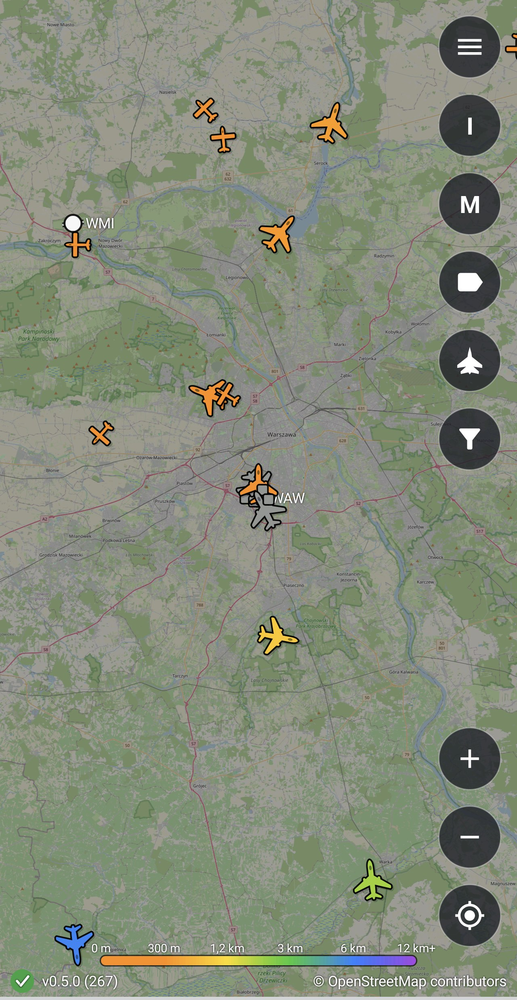
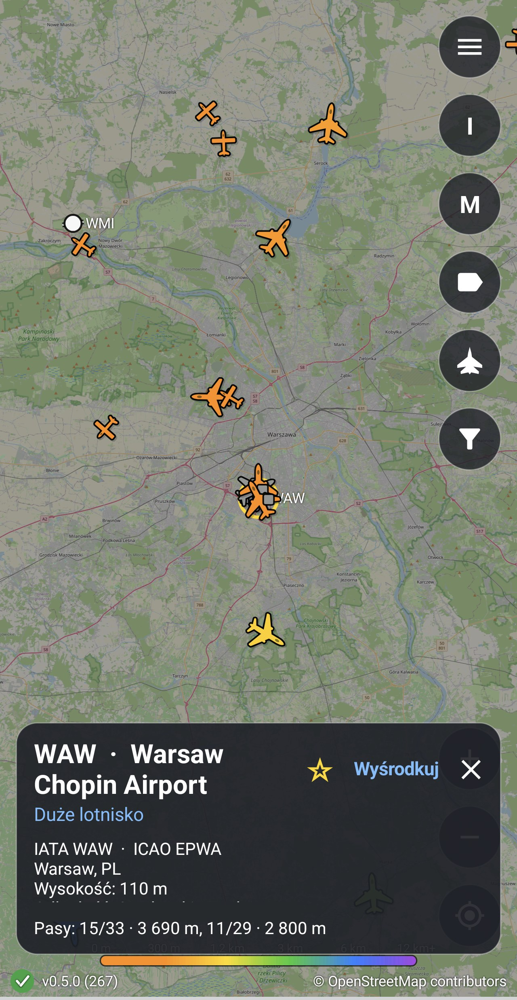
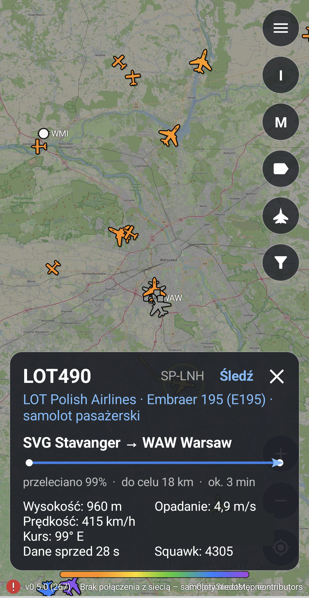
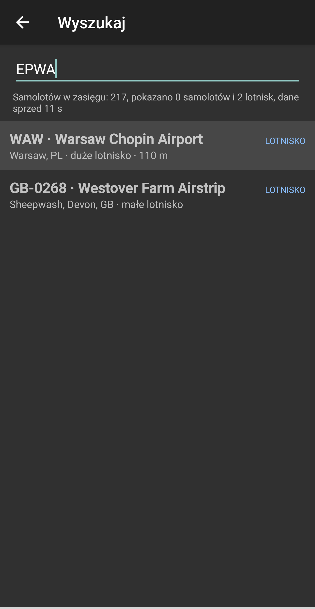
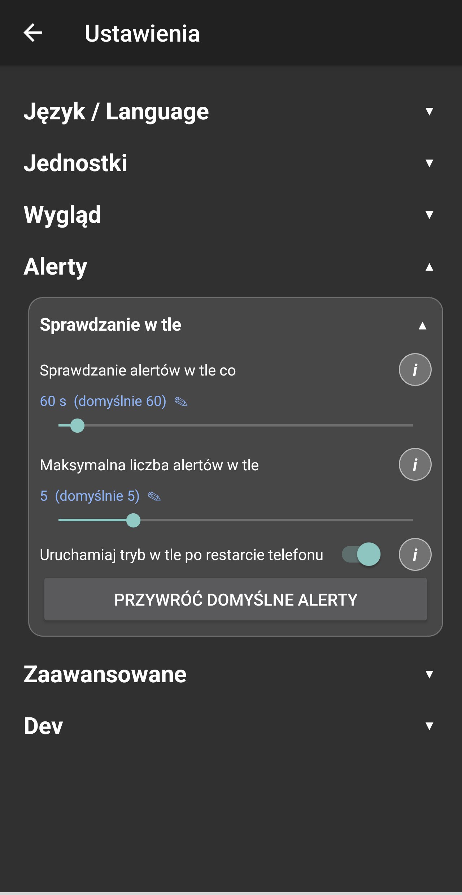
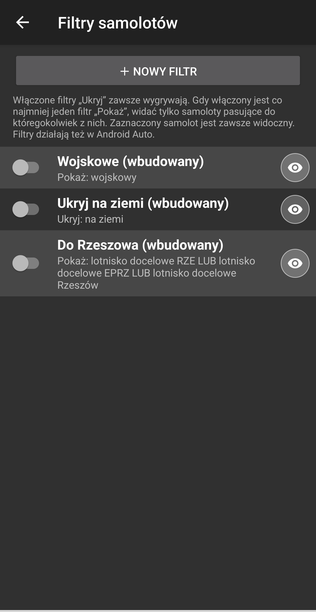

# ADS-B Car Map

Aplikacja na Androida, która pokazuje na mapie OpenStreetMap samoloty w powietrzu na żywo (dane ADS-B). Działa na telefonie, a także jako aplikacja nawigacyjna w Android Auto, rysowana własnym kodem na `Canvas`.

> **Status: proof of concept.** Mapa działa na telefonie i w Android Auto (sprawdzone w samochodzie i w DHU na wydaniu 0.4.0, patrz [Znane ograniczenia](#znane-ograniczenia)). Projekt jest przeznaczony do użytku własnego i instalacji z pliku (sideload), nie do Sklepu Play.

## Spis treści

- [Funkcje](#funkcje)
- [Jak to wygląda w użyciu](#jak-to-wygląda-w-użyciu)
- [Przykładowe zastosowania](#przykładowe-zastosowania)
- [Konfiguracja aplikacji](#konfiguracja-aplikacji)
- [Android Auto](#android-auto)
- [Budowanie ze źródeł](#budowanie-ze-źródeł)
- [Źródła danych i atrybucja](#źródła-danych-i-atrybucja)
- [Prywatność](#prywatność)
- [Znane ograniczenia](#znane-ograniczenia)
- [Struktura projektu](#struktura-projektu)
- [Ważna uwaga](#ważna-uwaga)
- [Licencja](#licencja)

## Funkcje

**Mapa**
- Kafelki OpenStreetMap rysowane na własnej powierzchni. Płynne, ciągłe przybliżanie (gest dwoma palcami i przyciski `+` / `−`), przesuwanie z bezwładnością.
- Podczas ładowania brakujące kafelki są zastępowane powiększonym fragmentem kafelka o niższym poziomie, a kafelki sąsiednie są wczytywane z wyprzedzeniem, więc przy przesuwaniu nie widać czarnych dziur.
- Kafelki są zapisywane także na dysku (pamięć podręczna w katalogu cache aplikacji), więc mapa pojawia się od razu po uruchomieniu i działa bez zasięgu w obszarach, które były już oglądane. Świeży kafelek jest brany z dysku bez pytania serwera, starszy niż ustawiony czas jest pobierany ponownie, a gdy pobranie się nie uda, używany jest starszy kafelek z dysku. Po przekroczeniu limitu rozmiaru usuwane są najstarsze kafelki. Limit, czas trzymania, aktualne zajęcie miejsca i przycisk „Wyczyść teraz” są w ustawieniach, w sekcji „Pamięć podręczna map”.
- Przycisk „center” wraca do Twojej pozycji GPS (niebieska kropka).

**Zagrożenia powietrzne (NEPTUN)**
- Osobna, domyślnie **wyłączona** warstwa mapy tylko na telefonie (w Android Auto jej nie ma): drony, rakiety, bomby kierowane i inne zagrożenia powietrzne zgłaszane przez serwis [NEPTUN](https://neptun.in.ua) (`neptun.in.ua`, otwarte API bez klucza). Włącza ją Ustawienia → Wygląd → „Warstwa zagrożeń (NEPTUN)” albo przycisk z ikoną ostrzeżenia w kolumnie przycisków na mapie (podświetlony, gdy warstwa jest włączona); wyłączona warstwa jest ukryta, a aplikacja w ogóle nie łączy się z serwisem.
- Znacznik to sylwetka rodzaju w stylu ikon samolotów, obracana o kierunek lotu: dron (delta ze śmigłem pchającym), dron FPV (cztery wirniki), dron rozpoznawczy (długie proste skrzydła i kopułka czujnika), rakieta (skrzydełka i usterzenie), rakieta balistyczna (wysoki korpus z długą głowicą), KAB (gruba bomba ze skrzydełkami), MiG-31K (myśliwiec z dwoma silnikami) i nieznane (romb). Rozmiar i obwódkę ikon zagrożeń ustawia się w tej samej karcie „Warstwa zagrożeń (NEPTUN)” co włączenie warstwy (Ustawienia → Wygląd): na górze jest przełącznik, pod nim podgląd wszystkich rodzajów z nazwami, a niżej suwaki; po wyłączeniu warstwy reszta karty jest wyszarzona. Cień i akcent kokpitu są wspólne z ikonami samolotów. Kolor zależy od rodzaju (ikona jest wtedy wyblakła, gdy kierunek jest tylko zakładany), koło niepewności położenia (przerywane, gdy położenie jest przybliżone), ślad ostatniej trasy i etykieta z rodzajem (przy zoomie od 7, bez nakładania; „×N” przy grupie). Ślad niepotwierdzany od dawna jest przyciemniony. Dotknięcie znacznika (gdy pod palcem nie ma samolotu) otwiera opis: rodzaj, miejsce, kierunek, prędkość w jednostce z ustawień, dokładność, wiarygodność, liczbę zgłoszeń i wiek danych.
- **Kierunek lotu.** Serwis podaje kierunek tylko dla części zagrożeń (np. dla dronów FPV zwykle go brak). Ikona zagrożenia z kierunkiem jest obrócona zgodnie z kursem, a dron FPV z kierunkiem ma dodatkowo wyraźny „nos” (grot między przednimi wirnikami). Gdy serwis nie podaje kierunku, aplikacja wylicza go z ruchu: z ostatnich dwóch punktów śladu albo z przesunięcia zagrożenia o co najmniej 1,5 km między kolejnymi odczytami (małe kroki sumują się względem miejsca ostatniego wyliczenia, a wyliczony kierunek jest zachowany, dopóki zagrożenie stoi w miejscu). Takie zagrożenie jest opisane w karcie jako „(z ruchu)”. Dopóki nie ma ani kierunku z serwisu, ani ruchu, dron FPV jest rysowany jako symetryczny, bez nosa, żeby ikona nie sugerowała kierunku; pozostałe rodzaje bez kierunku stoją prosto jak samoloty bez kursu.
- **Obserwacje i pozycje „tylko obwód”:** zagrożenie oznaczone przez serwis jako obserwacja (np. start MiG-31K) jest rysowane w neutralnym, niebiesko-szarym kolorze, nigdy na czerwono, i opisane jako „nie sygnał do schronienia”. Zagrożenie, o którym wiadomo tylko, w którym obwodzie jest, nie jest rysowane jako punkt (jego pozycja to środek obwodu, a nie miejsce) i nie ma kierunku, prędkości ani odległości.
- **Atrybucja i ostrzeżenie** (wymóg warunków użycia serwisu): gdy warstwa jest włączona, w lewym górnym rogu mapy widać klikalne „Dane: NEPTUN” (otwiera neptun.in.ua), liczbę zagrożeń lub stan połączenia i zdanie, że dane mogą być nieścisłe lub spóźnione, a obowiązują oficjalne sygnały alarmowe. Przy włączaniu przyciskiem aplikacja pokazuje pełne ostrzeżenie, że to nie jest oficjalny system ostrzegania.
- **Sposób pobierania** (Ustawienia → Zaawansowane → „Zagrożenia (NEPTUN): sposób pobierania”): „WebSocket z zapasowym pobieraniem” (domyślnie: jedno stałe połączenie ze strumieniem `wss://neptun.in.ua/api/v1/stream`, a gdy ono nie działa, lista jest pobierana co 5 s z `GET /api/v1/threats` i co jakiś czas następuje próba połączenia), „Tylko WebSocket” (po błędzie wykładnicza przerwa 1, 2, 4… do 60 s, bez pobierania) albo „Tylko pobieranie (REST)” (co 5 s, zgodnie z prośbą serwisu o nie częstsze zapytania). Połączenie jest zamykane, gdy mapa przechodzi w tło lub warstwa jest wyłączona. Serwis wysyła pełną listę po połączeniu, potem pojedyncze zmiany i co 15 s sygnał życia; brak jakiejkolwiek ramki przez 45 s uznajemy za zerwane połączenie.

**Strefy przestrzeni powietrznej (PAŻP)**
- Osobna, domyślnie **wyłączona** warstwa mapy tylko na telefonie (w Android Auto jej nie ma): strefy zakazane (P), ograniczone (R), niebezpieczne (D), czasowo wydzielone (TSA), czasowo zarezerwowane (TRA), rezerwacje doraźne (ADHOC), strefy ruchu lotniskowego (ATZ) i inne rodzaje z mapy PAŻP (`airspace.pansa.pl`, publiczny GeoJSON bez klucza). Włącza ją Ustawienia → Wygląd → „Strefy przestrzeni powietrznej (PAŻP)” albo przycisk z ikoną strefy w kolumnie przycisków na mapie (podświetlony, gdy warstwa jest włączona); dłuższe przytrzymanie przycisku otwiera wybór tego, co warstwa pokazuje. Wyłączona warstwa jest ukryta, a aplikacja w ogóle nie łączy się z serwisem.
- **Co warstwa pokazuje wybiera użytkownik, osobno dla każdego elementu** (ekran „Strefy przestrzeni powietrznej”: Ustawienia → Wygląd → „Wybierz rodzaje i stany stref” albo długie przytrzymanie przycisku): stany stref (aktywne, planowane, nieaktywne) i każdy rodzaj strefy z osobnym przełącznikiem, z liczbą stref i aktywnych. Lista rodzajów powstaje z danych, które serwis opublikował, więc nowy rodzaj pojawia się na niej sam, bez nowej wersji aplikacji; przełącznik „Pokazuj nowe rodzaje stref” decyduje, czy rodzaj, o którym jeszcze nie zdecydowałeś, jest od razu widoczny. Domyślnie widać aktywne strefy P, R, D, NPZ, TSA, ADHOC i MRT; liczne strefy TRA i ATZ włącza się przełącznikiem.
- Strefa **aktywna** ma potwierdzoną rezerwację, która obowiązuje teraz (rysowana pełną linią); **planowana** ma rezerwację zapowiedzianą na teraz lub na później, ale niepotwierdzoną (linia kreskowana); **nieaktywna** nie ma już rezerwacji (blada). Kolor zależy od rodzaju, a etykieta z oznaczeniem (np. EPD21) pojawia się od zoomu 8, bez nakładania.
- Dotknięcie strefy (gdy pod palcem nie ma samolotu, zagrożenia ani lotniska i nic nie jest zaznaczone) otwiera opis: rodzaj, stan, wysokości dolna i górna w jednostce z ustawień (ziemia jako GND, wysokość nad poziomem morza z dopiskiem AMSL, poziom lotu jako FL; w metrach lub stopach poziom lotu ma w nawiasie kod FL), czas obowiązywania w czasie telefonu, jednostka i uwagi. Gdy strefy się nakładają, wybierana jest najmniejsza. Aplikacja pobiera listę raz na kilka minut (suwak „Odświeżanie stref”, domyślnie 5 min), a po błędzie ponawia próbę coraz później (30 s, 60 s… do zwykłego odstępu); odpowiedź 429 wstrzymuje pobieranie na czas z `Retry-After`. Najpierw jest pytana mapa UUP, a gdy jest pusta lub nie odpowiada, mapa AUP.
- **Filtr wysokości** (ekran stref, sekcja „Filtr wysokości”): po włączeniu pokazuje tylko strefy, których zarezerwowana przestrzeń zahacza o wpisany przedział wysokości (np. od ziemi do pułapu, na którym latasz); przedział wybiera się jednym suwakiem z dwoma uchwytami (początek i koniec), a etykieta nad nim pokazuje „Od … do …” w jednostce wysokości z ustawień. Skok suwaka jest drobniejszy na małych wysokościach (500 ft do 10 000 ft, 1000 ft do 30 000 ft, potem 2000 ft), a koniec skali (FL660) oznacza „i wyżej”. Poziomy lotu są porównywane jako wysokości w stopach, bez poprawki na ciśnienie. Filtr dotyczy też powiadomień o strefach.
- **Powiadomienia o aktywacji stref** (ekran stref, sekcja „Powiadomienia o aktywacji stref”, domyślnie wyłączone): lokalne powiadomienie, gdy w zadanej odległości od Twojej pozycji (w jednostce odległości z ustawień, domyślnie 100 km) rezerwacja strefy wybranego rodzaju i wysokości zostaje potwierdzona jako aktywna albo ma się zacząć w ciągu ustawionego czasu uprzedzenia (domyślnie 30 min; 0 = dopiero gdy obowiązuje). Każda rezerwacja jest zgłaszana raz, także po ponownym uruchomieniu; zaraz po włączeniu aplikacja nie zgłasza stref, które już są aktywne. Przy czterech i więcej strefach naraz powstaje jedno zbiorcze powiadomienie z najbliższymi. Sprawdzanie działa po każdym pobraniu stref, gdy mapa jest otwarta, oraz w każdym cyklu trybu w tle alertów (Alerty → Sprawdzanie w tle); bez nich, gdy mapa jest w tle, nic się nie sprawdza. Powiadomienie otwiera mapę.

**Ostrzeżenia (RSO)**
- Ekran „Ostrzeżenia” tylko na telefonie (Menu → Ostrzeżenia albo Ustawienia → Zaawansowane → „Ostrzeżenia (RSO)” → „Otwórz ostrzeżenia”; w Android Auto go nie ma): oficjalne komunikaty Regionalnego Systemu Ostrzegania, które TVP udostępnia publicznym kanałem `komunikaty.tvp.pl` (bez klucza). Aplikacja łączy się z serwisem tylko wtedy, gdy ekran jest otwarty, i odświeża listę co kilka minut (suwak „Odświeżanie ostrzeżeń”, domyślnie 10 min); po błędzie ponawia próbę coraz później (30 s, 60 s… do zwykłego odstępu), a odpowiedź 429 wstrzymuje pobieranie na czas z `Retry-After`.
- **Co pokazywać wybiera użytkownik** (na tym samym ekranie): każda kategoria osobnym przełącznikiem (ogólne, meteorologiczne, hydrologiczne, informacje drogowe, stany wód; kategoria, której serwis jeszcze nie opublikował, pojawia się na liście, gdy tylko wystąpi w danych), województwa (lista z polami wyboru; brak wyboru oznacza wszystkie), pokazywanie komunikatów, które wygasły, i tryb „tylko oznaczone jako alarm”. Domyślnie włączone są kategorie ogólne, meteorologiczne i hydrologiczne, wszystkie województwa, bez wygasłych. Informacje drogowe (komunikaty o utrudnieniach) i stany wód (odczyty wodowskazów) włącza się przełącznikiem.
- Lista jest posortowana: najpierw komunikaty oznaczone jako alarm (czerwone tło i napis „ALARM”), potem według czasu ostatniej zmiany; do 100 pozycji. Dotknięcie komunikatu rozwija pełny tekst: skrót, treść, ważność od–do w czasie telefonu, czas ostatniej zmiany, a dla wodowskazu rzekę, stan wody, stan ostrzegawczy i alarmowy (w cm) z informacją o ich przekroczeniu. Komunikat bez województwa dotyczy całego kraju i przechodzi każdy wybór województw.
- **Zastrzeżenie** (zawsze widoczne na ekranie): komunikaty pochodzą z publicznego kanału, to nie jest oficjalny system ostrzegania, aplikacja może pokazać komunikat ze spóźnieniem, w niepełnej postaci albo wcale, a Alert RCB przychodzi SMS-em od operatora i nie jest dostępny w aplikacji (nie ma strumienia danych, który można by odczytać). U góry jest klikalne „Dane: RSO (TVP)”. Karta „Stan źródeł” ma grupę „Ostrzeżenia” ze stanem pobierania, wiekiem ostatniej aktualizacji i ostatnim błędem. Powiadomień o nowych komunikatach na razie nie ma.
- **Atrybucja i ostrzeżenie:** gdy warstwa jest włączona, pod napisem zagrożeń (w lewym górnym rogu) widać klikalne „Dane: PAŻP” (otwiera airspace.pansa.pl) i stan pobierania; przy włączaniu przyciskiem oraz na karcie strefy aplikacja zaznacza, że strefy są nieoficjalne, mogą być spóźnione lub niepełne i nie służą do planowania ani wykonywania lotów. Karta „Stan źródeł” ma grupę „Strefy przestrzeni powietrznej” ze stanem pobierania, wiekiem ostatniej aktualizacji i ostatnim błędem.
- Aplikacja nie wysyła do serwisu żadnej pozycji ani identyfikatora poza standardowym nagłówkiem User-Agent. Warstwa nie bierze udziału w alertach, wyszukiwarce ani filtrach samolotów.

**Lotniska**
- Dane z projektu OurAirports (domena publiczna), dołączone do aplikacji: około 71 tys. lotnisk i helipadów (duże, średnie, małe i helipady, bez wodnosamolotowych i zamkniętych) oraz pasy startowe. Dane odświeża skrypt `Scripts\Update-AirportData.ps1`, uruchamiany automatycznie przed każdym wydaniem.
- **Zapamiętany widok mapy:** przy zamknięciu mapy aplikacja zapisuje środek i zoom (zoom mieści się w aktualnych ustawieniach zoomu minimalnego i maksymalnego). Przy następnym uruchomieniu mapa zawsze zaczyna w trybie podążania za pozycją GPS: zapamiętany środek widać tylko do pierwszej pozycji GPS, potem mapa wyśrodkowuje się na Twojej pozycji, z zapamiętanym zoomem. Widok wczytuje pierwsza uruchomiona mapa, telefon albo samochód.
- Lotniska rysują się pod samolotami: w zakresie zoomu wybranym jedną kontrolką od–do (domyślnie od 5, bez górnego limitu), wspólnym dla wszystkich rodzajów; pola „Rodzaje lotnisk na mapie” wybierają, które rodzaje są widoczne. Znacznik jest większy dla większego lotniska, lotniska wojskowe są czerwone. Obok znacznika jest kod IATA (a gdy go brak, ICAO), a etykiety, które by się nakładały, są pomijane od tych mniej ważnych. Od zoomu 11 widać pasy startowe.
- Dotknięcie lotniska (gdy pod palcem nie ma samolotu) zaznacza je: na telefonie pojawia się karta, a w Android Auto popup, z nazwą, kodami IATA i ICAO, miastem i krajem, wysokością w wybranej jednostce, odległością i kierunkiem od Ciebie oraz najdłuższymi pasami. Karta ma przycisk „Wyśrodkuj”. Zaznaczenie lotniska jest wspólne dla telefonu i samochodu.
- Wyszukiwarka (telefon i Android Auto) szuka też lotnisk po kodzie, nazwie i mieście (bez względu na polskie znaki). Wyniki są uporządkowane według dopasowania, a przy takim samym dopasowaniu lotniska są przed samolotami. W samochodzie dwa wiersze z sześciu są zawsze zarezerwowane dla samolotów. Przy pustym polu na górze są trzy najbliższe lotniska. Wybór lotniska zaznacza je, centruje na nim mapę i przybliża do zoomu 11.
- **Ulubione lotniska:** osobny ekran w menu („Ulubione lotniska”). Ulubione są zawsze widoczne na mapie od zoomu 5, bez względu na wybrane rodzaje i filtr małych lotnisk, ze złotym pierścieniem i etykietą o najwyższym priorytecie. Dodajesz je gwiazdką na karcie lotniska, przyciskiem „＋” w wynikach wyszukiwania na tym ekranie albo w oknie szczegółów. Lista pozwala zmieniać kolejność (▲ ▼), usuwać (✕) i po dotknięciu wiersza zobaczyć szczegóły lotniska z przyciskiem „Pokaż na mapie”. W wyszukiwarce ulubione są przed innymi lotniskami o takim samym dopasowaniu, a przy pustym polu stoją na początku. Lista jest wspólna dla telefonu i samochodu (w samochodzie popup oznacza ulubione, zarządzanie jest na telefonie) i jest zapisana osobno od ustawień: „Przywróć wszystkie domyślne” jej nie kasuje.
- Ekran „O aplikacji” (menu) zawiera wersję, licencję, źródła danych z atrybucją (OpenStreetMap, adsb.lol, airplanes.live, adsb.fi, adsbdb, hexdb.io, OurAirports) i informację o prywatności. Atrybucja „© OpenStreetMap” zostaje też na mapie.

**Samoloty**
- Pozycje z ADS-B odświeżane domyślnie co 3 sekundy, a między odpowiedziami przesuwane na podstawie kursu i prędkości, żeby ruch był płynny.
- **Ikona zależna od rodzaju:** samolot pasażerski, szerokokadłubowy, mały odrzutowiec, turbośmigłowiec, awionetka, śmigłowiec, myśliwiec, wojskowy transportowiec, szybowiec, balon, dron, obiekt naziemny. Rodzaj wynika z kategorii nadajnika ADS-B, znacznika wojskowego i kodu typu ICAO.
- **Kolor zależny od wysokości:** szary na ziemi, a w powietrzu przejście od pomarańczowego przez żółty, zielony i niebieski do fioletowego.
- **Ślad lotu:** rysowany tylko dla zaznaczonych i wyizolowanych samolotów (pozostałe nie mają śladu, ale historia jest zbierana dla wszystkich, więc ślad pojawia się od razu po zaznaczeniu). Linia za samolotem w kolorze wysokości, coraz bardziej przezroczysta ku przeszłości. Przy zmianie wysokości kolor przechodzi płynnie (gradient wzdłuż każdego odcinka śladu).
- **Legenda wysokości:** pasek z gradientem kolorów u dołu mapy (telefon i Android Auto), z progami z ustawień: od 0 m, przez pomarańczowy, żółty, zielony i niebieski, do fioletowego (domyślnie od 12 km). Progi są rozmieszczone równomiernie, bo kolory przechodzą liniowo między nimi.
- **Etykieta:** znak wywoławczy i poziom lotu (np. `LOT281 FL350`), a pod spodem typ i trasa (np. `B738 WAW→LHR`). Etykiety są domyślnie **ukryte** (mapa jest wtedy czytelniejsza, a aplikacja nie pobiera tras dla każdego samolotu na ekranie). Włączysz je przyciskiem z ikoną etykiety pod „M” albo w ustawieniach; wybór jest zapamiętywany i obowiązuje też w Android Auto. Szczegóły samolotu zawsze widać na jego karcie po dotknięciu.
- Trasa lotu jest pobierana w tle (po jednym zapytaniu na sekundę) z jednego z trzech serwisów: adsbdb.com (podaje też nazwę linii lotniczej), adsb.lol lub hexdb.io. Kolejność wybiera się w ustawieniach zaawansowanych (lista do przeciągania), a gdy serwis nie zna lotu albo nie odpowiada, aplikacja pyta następny. Trasę z hexdb.io, która jest samą parą lotnisk, aplikacja uzupełnia kodami IATA, miastami i współrzędnymi z własnej bazy lotnisk.

**Karta samolotu**
- Po dotknięciu samolotu u dołu mapy pojawia się karta (odświeżana co sekundę): lot, rejestracja, linia lotnicza, typ i rodzaj, trasa z lotniskami wylotu i przylotu oraz **pasek postępu lotu**.
- Pod paskiem: ile procent trasy przeleciano, ile kilometrów zostało do celu i szacowany czas przylotu (z prędkości względem ziemi, więc to przybliżenie).
- Parametry lotu: wysokość (ft i m), prędkość (kt i km/h), kurs z kierunkiem świata, prędkość wznoszenia lub opadania, squawk oraz wiek danych.
- **Odległość i kierunek od Ciebie** (np. „34,2 km, NE (47°)”), liczone z pozycji GPS.
- Przycisk „Śledź” wyśrodkowuje mapę na samolocie, a „✕” zamyka kartę i czyści zaznaczenie. Przy kilku zaznaczonych samolotach karta pokazuje ostatnio dotknięty, a przy jego nazwie jest liczba pozostałych.
- Dane trasy i postęp są dostępne tylko dla lotów, które zna któryś z trzech serwisów tras. Pokrycie każdego jest niepełne: w próbie testowej część znaków wywoławczych (np. `WUK6351`) nie miała trasy. Wtedy karta pokazuje pozostałe dane, bez paska postępu.
- Karta mówi wprost, dlaczego trasy nie ma: „pobieranie…” (czeka w kolejce lub jest pobierana), „żadne źródło nie zna tego lotu” albo „nie udało się pobrać (błąd sieci lub limit zapytań)”. W każdym z tych przypadków jest przycisk („Pobierz teraz”, „Sprawdź ponownie”, „Spróbuj ponownie”), który wymusza pobranie trasy w pierwszej kolejności. Trasa samolotu pokazanego na karcie jest też pobierana poza kolejką, bez czekania na pozostałe.

**Wyszukiwanie** (menu → „Szukaj samolotu”)
- Pole wyszukiwania zawsze na górze, pod nim przewijana lista widocznych samolotów: lot, rejestracja, linia lotnicza, typ, trasa, wysokość. Wiersze na przemian w jaśniejszym tle.
- Wpisz lot, rejestrację, kod typu, lotnisko lub linię, aby zawęzić listę. Dotknięcie wiersza centruje mapę na samolocie i śledzi go.

**Zaznaczanie i izolacja**
- Dotknięcie samolotu na mapie zaznacza go (żółty pierścień).
- **M** włącza tryb zaznaczania wielu samolotów: dotknięcia dodają lub odejmują samoloty. W tym trybie karta samolotu się nie pokazuje, żeby nie zasłaniała mapy przy zaznaczaniu. Wróci po wyłączeniu „M”, jeśli coś zostało zaznaczone. Obok litery „M” widać **licznik zaznaczonych samolotów** w nawiasie, nieco niżej i mniejszą czcionką (np. „M(5)”). Pojawia się od dwóch zaznaczonych samolotów, także po wyłączeniu trybu wielokrotnego.
- **I** pokazuje tylko zaznaczone samoloty (reszta i ich ślady znika). Ponowne dotknięcie przywraca wszystkie.

**Filtr samolotów wojskowych**
- Przycisk z sylwetką myśliwca (pod przyciskiem etykiet) pokazuje na mapie wyłącznie samoloty, które baza oznacza jako wojskowe (flaga `dbFlags` z API ADS-B). Ponowne dotknięcie przywraca wszystkie. Po włączeniu aplikacja podaje, ile takich samolotów jest w zasięgu.
- Filtr działa do zamknięcia aplikacji i nie jest zapamiętywany. Można go łączyć z zaznaczaniem i izolacją.
- Flaga pochodzi z zewnętrznej bazy i bywa niedokładna: część wojskowych samolotów nie jest oznaczona, a część cywilnych (np. samoloty rządowe) może być oznaczona jako wojskowe.

**Filtry samolotów (osobny ekran)**
- Pod przyciskiem wojskowych jest przycisk **z lejkiem**. Dotknięcie otwiera listę filtrów. Gdy jakiś filtr jest włączony, przycisk świeci na niebiesko, a pomarańczowa plakietka w rogu pokazuje, ile filtrów jest włączonych (bez filtrów plakietki nie ma). Przycisk jest tylko na telefonie; w Android Auto filtry działają, ale nie ma ich wskaźnika.
- Ekran **Filtry samolotów** otwiera się też z menu mapy (przycisk menu, pozycja pod „Ulubione lotniska”). To lista filtrów z przełącznikiem włącz/wyłącz przy każdym. Filtrów nie ma w ustawieniach, a „Przywróć wszystkie domyślne” ich nie usuwa. Są zapamiętywane między uruchomieniami, osobno od ustawień.
- Wbudowane filtry (tylko do włączania i kopiowania): **Wojskowe** (pokazuje tylko samoloty oznaczone jako wojskowe), **Ukryj na ziemi** oraz **Do Rzeszowa** (pokazuje tylko loty, których lotniskiem docelowym jest Rzeszów: RZE lub EPRZ) oraz **Squawk awaryjny** (pokazuje tylko samoloty z kodem 7500, 7600 lub 7700; użyj go jako warunku alertu, żeby dostać powiadomienie o samolocie w stanie zagrożenia). Wbudowany filtr **Szybko opadające** pokazuje samoloty opadające szybciej niż 3000 ft/min. W kreatorze są też warunki „Squawk (kod transpondera)” dla dowolnego kodu oraz „Prędkość pionowa” z zakresem „od” i „do” w jednostce z ustawień (ft/min lub m/s; opadanie ma znak minus, np. „do” −3000 to opadanie szybsze niż 3000 ft/min). Samolot, który nie podaje prędkości pionowej (np. stojący na ziemi), nie pasuje do warunku, a wartość z transpondera bywa chwilowo zaszumiona. Dotknięcie wbudowanego filtru (albo ikony oka) otwiera go w kreatorze **tylko do odczytu**: widać nazwę, tryb i wszystkie warunki, ale nic nie da się zmienić, a przycisk „Kopiuj do własnych” tworzy własną kopię do edycji.
- **Kreator filtru** (przycisk „＋ Nowy filtr” albo ikona ołówka przy własnym filtrze; obok jest ikona kosza, która po potwierdzeniu usuwa filtr): nazwa, tryb (**pokaż** tylko pasujące samoloty albo **ukryj** pasujące) i **drzewo warunków** bez praktycznego limitu zagnieżdżeń (zapisać można do 100 poziomów). Warunek to jedno sprawdzenie, np. lotnisko docelowe, linia (początek znaku wywoławczego, np. LOT), producent, typ (kod ICAO lub IATA, np. `B738` albo `738`), rodzaj samolotu, wojskowy, na ziemi, wysokość od/do w metrach albo lotnisko wylotu (kod IATA/ICAO lub miasto, bez względu na wielkość liter i znaki diakrytyczne). **Grupa** łączy swoje elementy przez **ORAZ** (wszystkie) albo **LUB** (którykolwiek) i może zawierać warunki oraz inne grupy; przyciski „＋ warunek” i „＋ grupa” na końcu każdej grupy dodają elementy. Każdy warunek i każda grupa ma przełącznik **NIE**: po włączeniu cały element robi się czerwony, a jego wynik jest odwrócony (dla grupy odwrócona jest cała grupa). Pasek po lewej ma inny kolor na każdym poziomie, wcięcie rośnie do sześciu poziomów (głębiej przy grupie pojawia się numer poziomu), a strzałka ▾/▸ zwija grupę do jednej linii z jej treścią. Menu ⋮ elementu: przesuń wyżej, przesuń niżej, przenieś do grupy… (lista grup do wyboru), kopiuj i usuń (grupa z zawartością wymaga potwierdzenia). Na dole kreatora są dwie linie na żywo: **Opis** (z nawiasami, np. „Pokaż: (typ B744 ORAZ linia LOT ORAZ NIE na ziemi) LUB (typ B744 ORAZ linia CHG)”) i **Czytaj** (zdanie po polsku, np. „Pokazuje każdy samolot, który pochodzi od producenta Boeing oraz nie leci do lotniska WAW oraz nie leci do lotniska KRK.”; negacje grup są w nim rozpisane na warunki, a dla filtrów zagnieżdżonych głębiej niż cztery grupy zdania nie ma). Błędy (brak nazwy, pusty warunek, pusta grupa, wysokość „od” większa niż „do”) są pokazane komunikatem, a element, którego dotyczą, jest rozwijany, obramowany na żółto i przewijany na ekran; filtr się wtedy nie zapisuje. Nowy filtr jest zapisany jako wyłączony; włącza się go na liście. Wynik filtra zależy tylko od struktury drzewa, nie od kolejności elementów w grupie: warunki wymagające trasy (lotnisko) są liczone na końcu grupy, żeby nie pobierać tras dla samolotów już rozstrzygniętych prostszymi warunkami.
- **Typ samolotu w filtrze** można wpisać jako kod ICAO (`B738`) albo IATA (`738`, `73H`, `32N`); kod IATA jest zamieniany na kody ICAO według tabeli typów (`Assets/AircraftTypes/aircraft-types.tsv`: kod IATA, kod ICAO, rodzina, pełna nazwa). Pole **„Cała rodzina”** w warunku typu rozszerza dopasowanie na wszystkie typy rodziny z tabeli: `738` z tym polem obejmuje każde 737, także MAX, a `320` całą rodzinę A320 z wersjami neo. Nazwę rodziny (np. `B737`) też można wpisać. Bez tego pola pasuje tylko dokładny typ (z jego wariantami IATA). Typ spoza tabeli działa nadal jako dokładny kod ICAO, ale nie ma dla niego aliasu IATA ani rodziny. Starsze filtry bez tego pola są odczytywane jako „dokładnie”. Tabela ma około 200 typów (liniowce, regionalne, biznesowe, śmigłowce, wojskowe) i jest uzupełniana ręcznie; kody IATA, których nie jestem pewien, zostały puste.
- **Nazwy typów bez zapytań**: gdy źródła danych nie podały pełnej nazwy typu, karta samolotu, opis w wyszukiwarce i samo wyszukiwanie używają nazwy z wbudowanej tabeli typów (np. `A21N` jako „Airbus A321neo (A21N)”), więc samolot można znaleźć wpisując „airbus neo”. Działa offline, także dla niezaznaczonych samolotów.
- **Brakujące typy**: aplikacja zapamiętuje typy samolotów widziane w ruchu, których nie ma w tabeli typów (z przykładowym znakiem wywoławczym, rejestracją i kategorią oraz liczbą samolotów i czasem pierwszego i ostatniego zobaczenia), żeby wiadomo było, co dopisać. Lista jest w ustawieniach, w dziale **Dev**, w karcie „Dane developerskie” (przycisk „Brakujące typy samolotów (N)”). Ekran ma przyciski „Kopiuj listę” (tekst rozdzielany tabulatorami, gotowy do wklejenia do arkusza) i „Wyczyść listę”. Lista zajmuje najwyżej 2000 typów, jest zapisywana w prywatnym pliku aplikacji `missing-aircraft-types.tsv` nie częściej niż co 30 sekund i nigdzie nie jest wysyłana. Liczba oznacza samoloty zauważone od uruchomienia aplikacji, więc ten sam samolot widziany po restarcie liczy się ponownie. Samoloty bez kodu typu nie trafiają na listę. Typy, które po aktualizacji tabeli są już w niej opisane, znikają z listy same (przy otwarciu ekranu i przy kolejnych pobraniach samolotów).
- **Dev log**: dziennik nieprzewidzianych zdarzeń, który pozwala przekazać twórcy, co w aplikacji nie działa jak powinno. Trafiają do niego nieobsłużone wyjątki (także z Android Auto), nieudane pobrania (samoloty, trasy, kafelki, wyszukiwanie), odpowiedzi 429 i odmowy źródeł, błędy odczytu danych aplikacji oraz, na poziomie „Wszystko”, przełączenia na zapasowe źródło. Log zbiera się zawsze, a ekran pojawia się w menu głównym pod „O aplikacji” dopiero po włączeniu przełącznika „Pokaż Dev log w menu” (ustawienia, dział **Dev**, karta „Dev log”). Karta ma też ustawienia: **poziom logowania** (tylko błędy / błędy i ostrzeżenia, domyślnie / wszystko), **długość logu** (100, 250, 500, 1000 lub 2000 wpisów; po przekroczeniu najstarsze są usuwane) i **łączenie powtarzających się wpisów** (identyczne zdarzenie zwiększa licznik zamiast tworzyć nowy wpis; przy wyłączonym każde zdarzenie jest osobnym wpisem). Ekran „Dev log” pokazuje wpisy od najnowszych (kolor poziomu, licznik, czas pierwszego i ostatniego wystąpienia, po dotknięciu stos wyjątku) i ma przyciski „Udostępnij” (plik tekstowy przez systemowe okno udostępniania), „Kopiuj” (cały raport do schowka) i „Wyczyść”. Raport zaczyna się od opisu: wersja i kompilacja, urządzenie i wersja Androida, kolejność źródeł, ustawienia logu. Log jest zapisywany w prywatnym pliku `dev-log.tsv` kilka sekund po zmianie, a przy nieobsłużonym wyjątku od razu, więc przetrwa zamknięcie aplikacji. Nigdzie nie jest wysyłany automatycznie; do wysłania trafia tylko to, co sam udostępnisz.
- **Stan źródeł**: karta w Zaawansowane → „Stan źródeł” pokazuje dla każdego źródła samolotów (adsb.lol, airplanes.live, adsb.fi) i tras (adsbdb.com, adsb.lol, hexdb.io), w kolejności z ustawień, czy da się je teraz odpytać albo na ile sekund jest wstrzymane po 429 (odliczanie co sekundę), które źródło dało ostatnią odpowiedź („ostatnio użyte”) oraz ostatni błąd z kodem HTTP (np. 403 lub 429) i czasem, jaki od niego upłynął. Błąd znika po pierwszej udanej odpowiedzi tego źródła. Karta nie wysyła żadnych zapytań, a przy wyłączonym zapasowym źródle kolejne źródła pokazują się jako dostępne, choć nie są odpytywane. Na końcu karty jest grupa „Zagrożenia” ze stanem NEPTUN: warstwa wyłączona, łączenie, połączone (WebSocket) lub pobieranie co 5 s (REST) z liczbą zagrożeń, brak połączenia albo wstrzymane (gdy mapa jest w tle, a tak jest przy otwartych ustawieniach), wybrany tryb, wiek ostatniej aktualizacji i ostatni błąd. Dwie ostatnie informacje zostają po zamknięciu połączenia, więc w ustawieniach widać, co działo się na mapie.
- **Log zapytań**: przycisk „Pokaż log zapytań” na karcie „Stan źródeł” otwiera ekran z zapytaniami, które aplikacja wysłała na zewnątrz (pozycje samolotów, trasy, dane samolotu, kafelki mapy): metoda, host, kod odpowiedzi albo opis błędu sieci, czas trwania, ścieżka z zapytaniem i godzina. Filtr „Tylko błędy” zostawia odpowiedzi 4xx/5xx, brak odpowiedzi i przekroczenia czasu (zapytania anulowane przez samą aplikację, np. po przesunięciu mapy, nie są błędami), a lista hostów ogranicza widok do jednego serwera. Log trzyma ostatnie 500 zapytań tylko w pamięci i znika po zamknięciu aplikacji. Ścieżka zawiera wysyłane współrzędne (po zaokrągleniu z ustawień prywatności). Kafelki mogą szybko wypełnić log, wtedy pomaga filtr hosta.
- Zasady łączenia włączonych filtrów: samolot ukrywa każdy włączony filtr „ukryj”. Jeśli włączony jest co najmniej jeden filtr „pokaż”, widoczne są tylko samoloty pasujące do któregokolwiek z nich (np. „Wojskowe” razem z „Do Rzeszowa” pokazuje obie grupy). Zaznaczony samolot jest zawsze widoczny, a izolacja ma pierwszeństwo przed filtrami.
- Filtry działają na telefonie i w Android Auto, ale w samochodzie nie ma elementów do ich włączania, więc ustawia się je na telefonie. Przycisk wojskowych na mapie to osobny, szybki tryb niezależny od filtru „Wojskowe”.
- Filtry z lotniskiem (np. „Do Rzeszowa”) wymagają trasy lotu, której nie ma w danych ADS-B. Aplikacja pobiera ją w tle z serwisów tras (adsbdb.com, adsb.lol, hexdb.io), jedną trasę na sekundę (kolejka do 200 lotów), więc po włączeniu filtra mapa może być pusta przez kilkadziesiąt sekund, a samoloty bez znanej trasy nie są pokazywane. Przy gęstym ruchu pełne zapełnienie trwa kilka minut.
- Brak danych (np. nieznana jeszcze trasa, brak kodu typu) daje wynik „nieznany”, który nigdy nie pokazuje ani nie ukrywa samolotu. Dlatego warunek „NIE lotnisko docelowe WAW” nie przepuści samolotu o nieznanej trasie.
- Tabela producentów (`AircraftManufacturers`) przyporządkowuje kody typów ICAO do producentów (Boeing, Airbus, Embraer, Cessna i inni). Kody spoza tabeli mają producenta „nieznany”.
- **Alerty** (menu → „Alerty”): reguły, które pokazują powiadomienie na telefonie, gdy samolot spełniający wybrany filtr wleci w obszar („wlot”) albo pojawi się w nim już w środku, np. po starcie („pojawienie się”). Obszar to okrąg: wokół mojej pozycji GPS, wokół lotniska (kod ICAO lub IATA, także z ulubionych) albo wokół wybranego środka (współrzędne wpisane ręcznie, ze środka pobieranych danych, z mojej pozycji albo dotknięciem na mapie – przycisk „Wybierz środek na mapie”), o promieniu od 1 do odpowiednika 300 km (w jednostce odległości z ustawień, suwak liczy pełne jednostki). Obszarem może być też wielokąt (do 32 wierzchołków) lub prostokąt narysowany na mapie (przycisk „Narysuj na mapie”: dotykasz kolejnych wierzchołków, „Cofnij” i „Wyczyść” poprawiają rysunek, a dotknięcie istniejącego wierzchołka (także rogu prostokąta) od razu włącza jego przenoszenie: wierzchołek można przeciągnąć palcem albo dotknąć mapy w nowym miejscu (dotknięcie poza wierzchołkiem nadal pozwala przesuwać mapę, a „Cofnij” anuluje przenoszenie). Wierzchołek można też chwycić i od razu przeciągnąć, a jego przytrzymanie otwiera menu „Przesuń” i „Usuń”. Przytrzymanie boku wielokąta (także zamykającego) oferuje „Wstaw wierzchołek”: nowy wierzchołek powstaje na boku w miejscu palca, między dwoma sąsiednimi, i od razu można go przeciągnąć, a przełącznik „Prostokąt” zamienia rysowanie na dwa przeciwległe rogi); wielokąt musi być poprawny: jego boki (łącznie z zamykającym, od ostatniego wierzchołka do pierwszego) nie mogą się przecinać ani stykać, wierzchołki nie mogą się powtarzać, a kontur musi mieć niezerowe pole (przy złym rysunku kontur robi się czerwony, a podpowiedź mówi, co cofnąć; „Gotowe” i zapis alertu są wtedy zablokowane); alert reaguje tylko na samoloty wewnątrz konturu, a zapytania o samoloty używają okręgu opisanego na wielokącie. Rysowanie obszaru jest tylko na telefonie (w samochodzie obszary są tylko sprawdzane, nie rysowane), a wielokąt nie może przecinać południka 180°. Warunek to jeden z zapisanych filtrów samolotów (w tym wbudowanych; z filtra bierze się wyrażenie, niezależnie od tego, czy filtr pokazuje, czy ukrywa) albo „Każdy samolot”, a przycisk „Nowy filtr” otwiera kreator filtrów. Każdy alert ma przełączniki zdarzeń i czas ciszy o tym samym samolocie (domyślnie 30 min, 0 wyłącza ciszę); cisza dotyczy tylko tego alertu, więc ten sam samolot, który spełni warunki innego alertu, wywoła jego powiadomienie. Każdy alert ma też harmonogram: dni tygodnia, w które może powiadamiać, i opcjonalne godziny ciszy (od–do, także przez północ, według czasu telefonu). Poza harmonogramem alert nie wysyła powiadomień, ale nadal śledzi samoloty, więc po końcu ciszy nie dostaniesz powiadomień o samolotach, które już były w obszarze. Przełącznik Ustawienia → Alerty → „Pomijaj samoloty już obecne przy starcie alertu” (domyślnie wyłączony) sprawia, że samoloty będące już w obszarze przy pierwszym sprawdzeniu alertu (po starcie aplikacji lub trybu w tle albo po włączeniu alertu) nie wywołują powiadomienia „pojawienie się”. Powiadomienia trafiają też na ekran Android Auto (`CarAppExtender`: tytuł i treść, bez otwierania mapy po dotknięciu; wyłącza je Ustawienia → Alerty → „Powiadomienia alertów w Android Auto”, domyślnie włączone; nie sprawdzone jeszcze w samochodzie ani w DHU). Gdy jeden alert zadziała w jednym sprawdzeniu dla co najmniej tylu samolotów, ile ustawia suwak Ustawienia → Alerty → „Grupuj powiadomienia od liczby samolotów” (2–10, domyślnie 3), aplikacja pokazuje jedno zbiorcze powiadomienie („Alert – samolotów: 6” z listą znaków wywoławczych), a nie lawinę pojedynczych. Każdy alert ma wybór „Rodzaj powiadomienia”: głośne (dźwięk i wyskakujące, domyślnie), zwykłe (dźwięk, bez wyskakiwania) albo ciche (bez dźwięku i wyskakiwania); to trzy osobne kanały powiadomień, więc dźwięk można też zmienić w ustawieniach systemu. Powiadomienie ma przyciski „Pokaż na mapie” i „Wycisz na 1 h” (wycisza ten alert na godzinę, także po restarcie aplikacji; wyciszenie widać na liście alertów). Ekran „Historia alertów” (przycisk na ekranie „Alerty”) pokazuje ostatnie 200 powiadomień: czas, nazwę alertu, zdarzenie i opis samolotu, także samoloty zebrane w zbiorczym powiadomieniu; historię można wyczyścić. Przycisk „Sprawdź, ile samolotów pasuje teraz” liczy pasujące samoloty w ostatnio pobranych danych. Dotknięcie powiadomienia o jednym samolocie otwiera mapę z tym samolotem w trybie izolacji, z jego kartą. Dotknięcie powiadomienia zbiorczego (o kilku samolotach) otwiera mapę w trybie wielokrotnego zaznaczania („M”) z zaznaczonymi wszystkimi samolotami grupy, bez izolacji; mapa wyśrodkowuje się na nich i dobiera skalę tak, żeby mieściły się na ekranie (do zoomu 12), a pierwszy samolot z listy jest zaznaczeniem głównym (pokazuje jego kartę). W samochodzie samoloty grupy też są zaznaczone, ale bez trybu „M”. Zdarzenie „wylot” (pole wyboru „samolot wyleci z obszaru”, domyślnie wyłączone) zgłasza samolot, który spełniał alert w obszarze i go opuścił; samolot, który po prostu zniknął z danych, nie jest zgłaszany jako wylot, bo mógł tylko wyjść poza zasięg odbiorników albo wylądować. Wylot ma własny czas ciszy, więc szybki wlot i wylot dadzą oba powiadomienia. Na karcie samolotu (telefon) przycisk „Obserwuj” tworzy alert na ten jeden samolot (po adresie ICAO, niezależnie od filtru): okrąg 300 km wokół mojej pozycji GPS, zdarzenia wlotu i pojawienia się, cisza 60 min; ponowne dotknięcie („Obserwowany ✓”) usuwa ten alert. Obszar i zdarzenia takiego alertu można zmienić w edytorze, a samolot jest widoczny na liście alertów w linii „Samolot”. Ikona kopiowania na liście alertów tworzy wyłączoną kopię alertu z nazwą „Kopia: …”. Przyciski „Eksportuj alerty” i „Importuj alerty” zapisują wszystkie alerty (razem z własnymi filtrami, których używają; wbudowane filtry są na każdym telefonie) do pliku JSON udostępnianego przez systemowe okno udostępniania i wczytują taki plik wybrany w systemowym oknie wyboru pliku. Import zawsze dodaje alerty z nowymi identyfikatorami (nie nadpisuje istniejących) i dodaje tylko brakujące filtry; istniejący filtr o tym samym identyfikatorze zostaje bez zmian. Przełącznik na górze ekranu wyłącza wszystkie alerty. Alert, którego filtr usunięto, jest nieaktywny. **Tryb w tle** (przełącznik na ekranie „Alerty”, domyślnie wyłączony): usługa ze stałym powiadomieniem sama pobiera samoloty wokół obszarów alertów, niezależnie od tego, co pokazuje mapa, i sprawdza je co kilkadziesiąt sekund. Częstotliwość (Ustawienia → Alerty, suwak 30–600 s, domyślnie 60 s) i maksymalna liczba alertów sprawdzanych w tle (suwak 1–20, domyślnie 5) są zwykłymi ustawieniami aplikacji. Obszary leżące blisko siebie dzielą jedno zapytanie. Zapytania idą przez te same źródła, zaokrąglanie współrzędnych i limit zapytań co mapa. Po ponownym uruchomieniu telefonu i po aktualizacji aplikacji tryb w tle rusza sam, bez otwierania aplikacji. Żeby alerty wokół pozycji GPS miały wtedy pozycję, po włączeniu trybu w tle aplikacja najpierw upewnia się, że ma zgodę na powiadomienia (Android 13+; gdy system przestał pytać, otwiera ustawienia powiadomień aplikacji), a potem prosi o lokalizację „Zawsze zezwalaj” (Android 10+; zgoda jest opcjonalna). Brak którejkolwiek zgody widać w stanie trybu w tle (odbiornik `BootReceiver`; wyłącza to ustawienie Ustawienia → Alerty → „Uruchamiaj tryb w tle po restarcie telefonu”, domyślnie włączone). Pod przełącznikiem widać stan trybu w tle. Reguły są zapisane w osobnym pliku ustawień i nie znikają po zresetowaniu ustawień, a obszary nie są nigdzie wysyłane.
**Android Auto**
- Mapa z samolotami na ekranie samochodu, przyciski przybliżania i oddalania, centrowanie na pozycji, przesuwanie, wyszukiwarka samolotów.
- Górny pasek akcji (od lewej): **filtr samolotów wojskowych** (ikona myśliwca), **izolacja** zaznaczonego samolotu, **przycisk etykiet** (pokazuje lub ukrywa etykiety wszystkich samolotów, domyślnie ukryte; to samo ustawienie co na telefonie) i **wyszukiwarka**. Włączony tryb jest pokazany osobną ikoną: zieloną i z obwódką (host Android Auto ignoruje kolor nadany ikonie i pozwala na kolorowe tło tylko jednego przycisku w pasku, dlatego obwódka zostaje widoczna nawet wtedy, gdy host sam wybarwi ikonę): filtr wojskowych, centrowanie (gaśnie po ręcznym przesunięciu mapy), etykiety i izolacja. Krótki komunikat na ekranie mówi, co się włączyło.
- Pasek mapy po prawej: przesuwanie, przybliżanie, oddalanie i **centrowanie na pozycji GPS** (przy przyciskach zoomu; świeci, gdy mapa podąża za pozycją lub samolotem).
- Ikona stanu aplikacji w lewym dolnym rogu, zawsze widoczna, przed numerem wersji (telefon i Android Auto): zielony znak ✓ – wszystko działa; niebieski radar z napisem „Wyszukiwanie samolotów…” – pobieranie listy samolotów; niebieska lupka z napisem „Pobieranie danych samolotu…” – pobieranie trasy zaznaczonego samolotu; niebieskie kółko z napisem „Wczytywanie mapy…” – pobieranie kafelków; czerwony wykrzyknik z napisem „Brak połączenia z siecią – samoloty niedostępne” – ostatnie pobranie samolotów się nie udało (np. brak zasięgu); pomarańczowa pauza z licznikiem – limit zapytań (429).
- Ekran startowy: przy zimnym starcie telefon pokazuje ciemne tło mapy z ikoną aplikacji zamiast białego błysku (na Androidzie 12 i nowszym to systemowy ekran startowy). Do czasu pierwszej odpowiedzi z serwera samolotów na środku mapy widać napis „Wczytywanie…” (telefon i Android Auto).
- Dotknięcie samolotu na ekranie dotykowym samochodu zaznacza go (pierścień), a wybór z wyszukiwarki też go zaznacza. **Zaznaczony samolot zawsze ma etykietę** (lot, poziom, typ i trasa), nawet gdy etykiety pozostałych są ukryte, bo w samochodzie nie ma karty samolotu. Zaznaczasz jeden samolot na raz, bo nie ma trybu „M”.
- **Okienko z danymi zaznaczonego samolotu** (lewy dolny róg mapy): lot i rejestracja, linia, typ i rodzaj, trasa z paskiem postępu, wysokość, prędkość, kurs, wznoszenie, odległość od Ciebie i squawk. Samolotów przysłoniętych przez okienko nie da się zaznaczyć, a dotknięcie okienka nic nie zmienia. Dotknięcie pustego miejsca na mapie zamyka okienko.
- Wybór samolotu z wyszukiwarki centruje na nim mapę, **automatycznie włącza izolację** i pokazuje okienko.

**Telefon i samochód działają tak samo i są zsynchronizowane**
- Zaznaczenie samolotu, izolacja i filtr samolotów wojskowych są wspólne: zmiana na telefonie od razu widać w samochodzie i odwrotnie. Wspólne są też ustawienia (np. etykiety). Wspólne jest też centrowanie: „Śledź” samolot i przycisk centrowania na pozycji działają na obu mapach naraz (ręczne przesunięcie mapy przerywa śledzenie tylko na tej mapie). Niezależne są pozycja po ręcznym przesunięciu i przybliżenie, a tryb „M” (wielokrotne zaznaczanie) działa tylko na telefonie.
- Wybór samolotu w wyszukiwarce (na telefonie albo w samochodzie) pokazuje go na obu mapach: centruje, zaznacza i izoluje.
- Zaznaczenie innego samolotu na jednym ekranie (dotknięciem, z wyszukiwarki) centruje na nim mapę także na drugim ekranie.
- Gdy samolot zaznaczony na jednym ekranie jest poza obszarem danych drugiego, drugi ekran przenosi się do niego i od razu pobiera samoloty w tej okolicy (zamiast pokazywać „poza zasięgiem danych”); dane zaznaczonego samolotu są przekazywane między ekranami, więc działa to także, gdy serwer akurat odmawia zapytań. Limit zapytań (429) jest wspólny: gdy serwer każe czekać, wstrzymują się oba ekrany.
- Na telefonie samolotów przysłoniętych przez kartę samolotu nie da się zaznaczyć, tak jak w samochodzie pod okienkiem.

## Jak to wygląda w użyciu

| Element | Gdzie |
|---|---|
| Menu (trzy kreski) | prawy górny róg: „Wyszukaj”, „Ulubione lotniska”, „Ustawienia” i „O aplikacji” (oraz „Dev log”, gdy włączono go w ustawieniach) |
| `I`, `M`, etykiety i filtr wojskowych | prawy górny róg, pod menu |
| `+`, `−`, „center” | prawy dolny róg |
| Wersja aplikacji | lewy dolny róg mapy |
| Atrybucja OSM | prawy dolny róg mapy |

### Zrzuty ekranu

| Mapa | Karta lotniska | Karta samolotu |
|---|---|---|
|  |  |  |

| Wyszukiwanie | Ustawienia | Filtry samolotów |
|---|---|---|
|  |  |  |

## Przykładowe zastosowania

1. **Obserwacja lotniska.** Ustaw mapę nad lotniskiem, przybliż do poziomu 11–13. Widzisz podchodzące i startujące samoloty z linią, typem i trasą, a ślady pokazują, którędy lecą.
2. **Co to leci nad głową?** Dotknij samolotu, który słyszysz. Zaznaczenie pokazuje jego lot, typ i trasę. Włącz izolację („I”), żeby odciąć resztę ruchu.
3. **Śledzenie konkretnego lotu.** Wyszukaj numer lotu lub rejestrację w oknie wyszukiwania, wybierz wiersz. Mapa wyśrodkuje się na samolocie i będzie za nim podążać.
4. **Porównanie kilku samolotów.** Włącz „M”, zaznacz kilka samolotów (np. kilka lotów jednej linii albo samoloty w jednym korytarzu powietrznym), włącz „I” i obserwuj tylko je.
5. **Pasażer w samochodzie.** Po podłączeniu do Android Auto na ekranie auta jest ta sama mapa. Wyszukiwarka i przyciski pozwalają szybko znaleźć samolot (patrz uwagi o bezpieczeństwie).

## Konfiguracja aplikacji

Menu → „Ustawienia”. Wartości są zapisywane na urządzeniu i obowiązują na telefonie oraz w Android Auto. Przy ustawieniach liczbowych, przełącznikach i liście jednostki jest okrągły przycisk „i”, który otwiera okienko z opisem, co dokładnie robi to ustawienie, wraz z przykładem (etykieta w bieżącej wielkości, pasek legendy z bieżącymi progami, ta sama wartość we wszystkich dostępnych jednostkach). Liczby wpisuje się w polach tekstowych, ustawienia włącz/wyłącz zmienia się przełącznikami, a wybór jednostki listą rozwijaną. Wartości spoza dozwolonego zakresu są ucinane, puste pola zostają bez zmiany. Ustawienia są pogrupowane w zwijane działy, domyślnie zwinięte: **Język / Language** (po rozwinięciu od razu widać „Język aplikacji” i listę wyboru: polski lub angielski; zmiana działa od razu na telefonie i w Android Auto), **Jednostki** (cztery niezależne listy: wysokość, odległość, prędkość i prędkość pionowa), **Wygląd** (Samoloty: ikony i etykiety, ślady, kolory wysokości ze skalą i legendą; Lotniska; Mapa: zoom i przyciemnienie), **Zaawansowane** (źródła danych, karta „Prywatność”, odświeżanie, pobieranie kafelków, pamięć podręczna map, „Przywróć wszystkie domyślne”) i **Dev** (wersja, karta „Dev log” z ustawieniami dziennika zdarzeń, karta „Prywatność (zaawansowane)” i brakujące typy samolotów). Wewnątrz działów karty też się zwijają; dział i kartę rozwija strzałka ▾/▴ albo dotknięcie nagłówka, a stan jest pamiętany tylko, dopóki ekran ustawień jest otwarty (także po obrocie ekranu i zmianie języka); po zamknięciu ustawień i ponownym wejściu wszystko jest zwinięte. Każdy przycisk „Przywróć domyślne…” najpierw pyta o potwierdzenie: okienko ma przyciski „Anuluj” i „Przywróć domyślne wartości”, a ten drugi jest nieaktywny przez pierwsze 10 sekund (z odliczaniem w napisie).

| Ustawienie | Domyślnie | Zakres | Znaczenie |
|---|---|---|---|
| Odświeżanie samolotów [s] | 3 | 1–60 | odstęp między zapytaniami o samoloty |
| Odstęp klatek mapy [ms] | 33 | 16–1000 | tempo rysowania (33 ms to ok. 30 klatek/s) |
| Minimalny zoom | 4 | 1–18 | największe oddalenie |
| Maksymalny zoom | 13 | 1–18 | największe przybliżenie |
| Kafelki w pamięci | 128 | 16–1024 | liczba zdekodowanych kafelków w pamięci (zawsze co najmniej tyle, ile widać na ekranie plus zapas) |
| Ponowienie kafelka [s] | 15 | 1–600 | po jakim czasie ponawiane jest nieudane pobranie kafelka |
| Kolejność źródeł samolotów | adsb.lol, airplanes.live, adsb.fi | wszystkie kolejności źródeł | lista przeciągana za uchwyt ≡ (Zaawansowane → Źródło danych): wiersz na górze (GŁÓWNE) to główne źródło, wiersze pod nim (ZAPASOWE 1, 2…) są pytane po kolei, gdy poprzedni nie zwraca danych; zapasowe są przyciemnione, gdy zapas jest wyłączony; zmiana działa od następnego odświeżenia |
| Kolejność źródeł tras | adsbdb.com, adsb.lol, hexdb.io | wszystkie kolejności źródeł | lista przeciągana za uchwyt ≡ (Zaawansowane → Źródła tras): pierwszy serwis to główne źródło tras, kolejne są pytane, gdy poprzedni nie zna lotu albo nie odpowiada; zmiana działa od następnego pobrania trasy |
| Zapasowe źródło przy braku danych | włączone | wł./wył. | gdy główne źródło nie zwraca danych (429, błąd sieci lub serwera), aplikacja pyta kolejne według kolejności; dotyczy samolotów i tras (przy trasach także gdy źródło nie zna lotu) |
| Uzupełniaj dane zaznaczonego samolotu | włączone | wł./wył. | gdy główne źródło nie podaje typu, rejestracji lub pełnej nazwy typu zaznaczonego samolotu, aplikacja dopytuje o ten jeden samolot (po kodzie ICAO) adsbdb.com, hexdb.io, a potem pozostałe źródła, i uzupełnia typ, pełną nazwę typu, producenta, właściciela i rejestrację, niczego nie nadpisując (nie częściej niż raz na czas pamiętania lotu) |
| Dokładność wysyłanego położenia | około 1 km | lista wyboru | Zaawansowane → Prywatność: dokładne, około 1, 5, 10 albo 25 km. Środek zapytania o samoloty jest przyciągany do siatki o tym rozmiarze, więc serwer widzi okolicę, a nie dokładne miejsce (przy śledzeniu GPS to Twoje położenie). Wynik zależy tylko od położenia (bez losowego szumu), więc wielu zapytań nie da się uśrednić. Promień rośnie o największe możliwe przesunięcie środka, żeby widoczny obszar był w całości pokryty; im większa siatka, tym większa odpowiedź serwera. Zmiana działa od następnego odświeżenia |
| Ustawienia Dev nadpisują ustawienia użytkownika | wyłączone | przełącznik | Dev → Prywatność (zaawansowane): gdy włączone, o zaokrąglaniu decyduje wyłącznie ta karta (siatka, promień, powiększanie, logowanie), a wybór z Zaawansowane → Prywatność jest ignorowany; gdy wyłączone, pozostałe ustawienia karty są wyszarzone i nie mają wpływu |
| Własny rozmiar siatki [km] | 5 | 0–50 | Dev: suwak co 1 km, działa tylko przy włączonym nadpisywaniu; 0 oznacza dokładne położenie |
| Zaokrąglanie promienia w górę | bez zaokrąglania | lista wyboru | Dev: zaokrągla promień zapytania w górę do 10, 20 albo 50 km, żeby serwer nie widział dokładnego poziomu przybliżenia |
| Powiększaj promień o błąd zaokrąglenia | włączone | przełącznik | Dev: wyłączenie pokazuje działanie bez pokrycia widocznego obszaru (przy brzegu ekranu mogą brakować samolotów) |
| Loguj wysyłane współrzędne w Dev logu | wyłączone | przełącznik | Dev: każde zapytanie o samoloty trafia do Dev logu (poziom „Wszystko”) z prawdziwym położeniem i położeniem wysłanym do serwera; przy włączeniu nie udostępniaj logu |
| Limit pamięci podręcznej [MB] | 100 | 10–1000 | maksymalny rozmiar kafelków na dysku, suwak co 10 MB; zmniejszenie limitu od razu usuwa najstarsze kafelki |
| Czas pamiętania lotu po ostatnim zobaczeniu [min] | 10 | 1–30 | jak długo po ostatnim zobaczeniu samolotu na mapie aplikacja pamięta trasę lotu (po znaku wywoławczym) i dane samolotu uzupełnione z innych źródeł (typ, rejestracja), także po ponownym uruchomieniu (Zaawansowane → Pamięć podręczna lotów). Dopóki samolot jest widoczny, jego dane są odświeżane i nie są pobierane ponownie, nawet gdy leci wiele godzin; zniknięty samolot jest zapominany po tym czasie, a samolot, który właśnie wylądował, po ok. 2 minutach. Odpowiedź „serwer nie zna tego lotu” jest pamiętana krócej (trasy do 6 godzin, dane samolotu do 10 minut, nigdy dłużej niż wybrany czas). Przycisk „Wyczyść teraz” zapomina wszystko |
| Czas trzymania kafelków [dni] | 7 | 1–90 | przez ile dni kafelek z dysku jest świeży i używany bez pytania serwera; starszy służy jako zapas, gdy pobranie się nie uda |
| Długość śladu [min] | 30 | 0–120 | jak długo pamiętany jest ślad lotu (0 wyłącza ślady), suwak co 1 min |
| Maks. punktów śladu | 700 | 10–5000 | limit punktów jednego śladu, suwak co 10 |
| Grubość śladu [dp] | 3 | 0,5–20 | suwak co 0,5 dp |
| Krycie najstarszego śladu | 140 | 0–255 | suwak co 5 |
| Krycie najnowszego śladu | 255 | 0–255 | suwak co 5 |
| Obwódka śladu [dp] | 1 | 0–10 | ciemna obwódka pod śladem, suwak co 0,5 dp |
| Krycie obwódki | 140 | 0–255 | |
| Przyciemnienie mapy | 90 | 0–220 | krycie czarnej warstwy nad kafelkami (0 wyłącza), im więcej, tym ciemniejsza mapa |
| Rozmiar ikon samolotów | ×1,0 | ×0,6–×2,0 | suwak co 0,1, mnoży rozmiar wszystkich ikon, kółek zaznaczenia i śledzenia oraz odsunięcie etykiety, na telefonie i w Android Auto. Grubość obwódki nie zmienia się z rozmiarem ikony. |
| Obwódka samolotów [dp] | 1,2 | 0–6 | suwak co 0,1 dp (0 wyłącza obwódkę). Oba suwaki są w jednej ramce „Ikony samolotów” po skali kolorów wysokości, nad suwakami jest podgląd wszystkich ikon samolotów w bieżącym rozmiarze i grubości obwódki. |
| Cień samolotów [%] | 40 | 0–100 | suwak co 5 % (0 wyłącza cień), miękki cień ikony w prawo i w dół, odsuwany proporcjonalnie do rozmiaru ikony; nie dotyczy znacznika obiektu naziemnego. |
| Akcent kabiny [%] | 60 | 0–100 | suwak co 5 % (0 wyłącza akcent), ciemna szyba kokpitu na ikonie samolotu, śmigłowca i drona, pokazuje kierunek lotu przy małych ikonach. Balon, obiekt naziemny i strzałka nie mają kabiny. Oba suwaki są w ramce „Ikony samolotów”, podgląd ikon pokazuje je na bieżąco. |
| Etykiety samolotów | wyłączone | przełącznik | pokazuje lub ukrywa etykiety (to samo robi przycisk na mapie) |
| Lotniska na mapie | włączone | przełącznik | pokazuje lotniska i pasy startowe |
| Tylko ulubione lotniska | wyłączone | przełącznik | pod głównym przełącznikiem: pokazuje na mapie wyłącznie ulubione lotniska, przy każdym zoomie. Rodzaje lotnisk, filtr małych lotnisk i zakres zoomu są wtedy wyszarzone, a podgląd pokazuje wszystkie rodzaje jako ukryte. |
| Rozmiar ikon zagrożeń | ×1,2 | suwak 0,6–2,5 co 0,1 | wielkość ikon dronów, rakiet i innych zagrożeń na mapie telefonu, niezależna od rozmiaru ikon samolotów (karta „Warstwa zagrożeń (NEPTUN)” z podglądem wszystkich rodzajów pod przełącznikiem) |
| Obwódka zagrożeń | 1,2 dp | suwak 0–6 dp co 0,1 | szerokość ciemnej obwódki ikon zagrożeń, 0 ją wyłącza; cień i akcent ikon są wspólne z ikonami samolotów |
| Rodzaje lotnisk na mapie | duże, średnie | pola wyboru | zaznaczasz, które rodzaje widzisz: duże, średnie, małe, wojskowe (czerwone, każdej wielkości, domyślnie wyłączone) i helipady (jasnoniebieskie, domyślnie wyłączone). Zmiana domyślnej wartości nie dotyczy telefonów, na których ustawienie było już zapisane. Zakres zoomu nie zależy od rodzaju. Małych lotnisk jest najwyżej 60, a helipadów 40 na klatkę (najbliższe środka ekranu). Pola zastąpiły dawny wybór zakresu z listy. |
| Małe: tylko z utwardzonym pasem od 800 m | wyłączone | przełącznik | ogranicza małe lotniska do tych z asfaltowym lub betonowym pasem od 800 m (w Polsce kilkanaście z ponad 300, na świecie około 4800 z ponad 42 tys.). Przełącznik jest wyszarzony, dopóki małe lotniska są odznaczone, a jego przycisk „i” zostaje aktywny i to wyjaśnia. Ulubione lotniska omijają ten filtr. |
| Kody lotnisk | włączone | przełącznik | kod IATA albo ICAO obok znacznika |
| Zakres zoomu, w którym widać lotniska | od 5, bez górnego limitu | dwa uchwyty | jedna kontrolka ze skalą całego zakresu zoomu mapy (z ustawień zoomu minimalnego i maksymalnego): lewy uchwyt to zoom, od którego widać lotniska, a prawy to zoom, powyżej którego znikają (prawy koniec skali oznacza brak górnego limitu). Zakres jest taki sam dla wszystkich rodzajów, o rodzajach decydują pola wyboru. Pod skalą jest zapis zakresu, a pod markerami w podglądzie to samo. Ulubione są widoczne od zoomu 5 niezależnie od tego zakresu. |
| Wielkość kodów lotnisk [dp] | 11 | 6–30 | suwak co 0,5 dp |
| Legenda wysokości | włączona | przełącznik | pokazuje lub ukrywa pasek legendy kolorów wysokości |
| Jednostka wysokości | metry | lista wyboru | metry (m, km w legendzie), stopy (ft) albo poziom lotu (FL, setki stóp). Pokazuje się: na etykietach samolotów na mapie; w wynikach wyszukiwania (wysokość samolotu i lotniska); w linii „Wysokość” karty i popupu samolotu; w linii „Wysokość” karty i popupu lotniska oraz w długościach pasów (w stopach i poziomach lotu pasy są w stopach); w legendzie i w edytorze skali kolorów; w powiadomieniach alertów; w filtrach (nazwa pola „Wysokość [m/ft/FL]”, wpisywanie granic i opis filtra; filtry zapisują granice w metrach, więc zmiana jednostki niczego w nich nie psuje). Karta pokazuje tylko wybraną jednostkę. |
| Jednostka odległości | kilometry | lista wyboru | kilometry (km), mile morskie (NM, 1,852 km) albo mile lądowe (mi, 1,609 km). Pokazuje się: w linii postępu karty i popupu samolotu („do celu”) i w linii „Od Ciebie”; w linii „Odległość” karty i popupu lotniska; w alertach (promień obszaru w edytorze i na liście oraz odległość samolotu w powiadomieniu). Nie dotyczy ustawień prywatności w sekcji Dev, które zawsze są w km. |
| Jednostka prędkości | km/h | lista wyboru | kilometry na godzinę (km/h), węzły (kt) albo mile na godzinę (mph). Pokazuje się w linii „Prędkość” karty i popupu zaznaczonego samolotu. Szacowany czas do celu nie zależy od tego ustawienia. |
| Jednostka prędkości pionowej | ft/min | lista wyboru | stopy na minutę (ft/min) albo metry na sekundę (m/s). Pokazuje się w linii „Wznoszenie”/„Opadanie” karty i popupu zaznaczonego samolotu; próg lotu poziomego (poniżej 100 ft/min) jest taki sam w obu jednostkach. |
| Wielkość liter etykiet [dp] | 13 | 6–40 | suwak co 0,5 dp z podglądem przykładowej etykiety w wybranej wielkości |
| Skala kolorów wysokości | 300 / 1200 / 3000 / 6000 / 12000 m | 50–20000 m | jeden edytor zamiast pięciu pól: pasek z gradientem i pięcioma znacznikami (pomarańczowy, żółty, zielony, niebieski, fioletowy). Znacznik przeciąga się palcem (nie przejdzie przez sąsiada, wartości przyciągają się do 50 m albo 100 ft), a dotknięcie otwiera okienko do wpisania dokładnej wartości w wybranej jednostce. Szary punkt po lewej to ziemia (0), a pierwszy próg nie może być niższy niż 50 m, żeby strefa pomarańczowa nie zniknęła. Skala paska jest pierwiastkowa, żeby niskie progi się nie zlewały. Pod paskiem jest podgląd śladu wznoszącego się samolotu w tych samych kolorach co na mapie. Kolory są stałe. Sekcja jest wydzielona w ramce, a przycisk „Przywróć domyślne kolory” ustawia domyślne progi i zapisuje je od razu. Wartości są zapisywane w metrach. |

Każda zmiana zapisuje się od razu, na telefonie i w Android Auto, bez przycisku „Zapisz”. Pola liczbowe zapisują się po opuszczeniu pola (Gotowe albo dotknięcie innego miejsca), suwaki i lista na bieżąco. Przy suwakach, liście jednostki i polach liczbowych jest przycisk „↺” (cofnij), widoczny, gdy jest co cofać: każde dotknięcie cofa kolejną zmianę o jeden krok (przeciągnięcie suwaka i wpisanie wartości to po jednej zmianie). Historia zmian jest w pamięci aplikacji: zostaje po wyjściu z ustawień, ale znika po zamknięciu aplikacji. Przełączniki i skala kolorów nie mają cofania. Ramki „Ikony samolotów” i „Ślady samolotów” mają własne przyciski przywracające domyślne wartości, a na dole jest „Przywróć wszystkie domyślne”. Przywrócenie domyślnych też można cofnąć „↺”.

Wszystkie suwaki: dotknięcie niebieskiej wartości pod nazwą (✎) otwiera okienko do wpisania dokładnej liczby z zakresu, także pomiędzy pozycjami suwaka.

Ustawienia lotnisk są w jednej ramce po skali kolorów wysokości. Na samej górze jest przełącznik „Lotniska na mapie”, a pod nim „Tylko ulubione lotniska”; po wyłączeniu głównego przełącznika cała reszta ramki (podgląd, suwaki, pola, przełączniki, przyciski) jest wyszarzona i nieaktywna, tylko przyciski „i” działają. Pod przełącznikiem jest podgląd pięciu rodzajów lotnisk z nazwami rodzajów (duże, średnie, małe, wojskowe, helipady) pod markerami w wielkości kodów; rodzaje wyłączone są wyszarzone. Zaraz pod podglądem jest suwak „Wielkość kodów lotnisk”, a dalej kolejno: „Kody lotnisk”, „Rodzaje lotnisk na mapie”, „Małe: tylko z utwardzonym pasem od 800 m” i zakres zoomu, w którym widać lotniska. Ten sam podgląd jest w okienkach „i” tych ustawień, a ramka ma przycisk „Przywróć domyślne lotniska”.

Ustawienia śladu (od „Długość śladu” do „Krycie obwódki”) są w jednej ramce „Ślady samolotów”, po ramce „Ikony samolotów”. Na górze ramki jest podgląd śladów trzech samolotów (dron, śmigłowiec, samolot pasażerski) rysowanych tym samym kodem co mapa, z bieżącymi wartościami suwaków i z progami kolorów wysokości. Podgląd zmienia się na bieżąco podczas przesuwania suwaków.

**Wskazówki**
- Wolniejszy wyświetlacz w samochodzie? Zwiększ „Odstęp klatek mapy” (np. do 50–66 ms).
- Obciążenie sieci i bateria spadają po zwiększeniu „Odświeżania samolotów”. Zbyt częste zapytania kończą się odpowiedzią 429 z API i aplikacja zwalnia sama (patrz niżej).

**Uprawnienia**
- **Lokalizacja:** potrzebna do niebieskiej kropki i przycisku „center”. Bez niej mapa działa, ale nie śledzi Twojej pozycji.
- **Usługa pierwszoplanowa (lokalizacja) i powiadomienia:** gdy aplikacja liczy pozycję, Android wymaga stałego powiadomienia „Śledzenie pozycji”. Bez niego system zatrzymałby pobieranie pozycji, gdy ekran telefonu jest wygaszony, a mapa działa w samochodzie.
- **Internet:** kafelki, samoloty, trasy.

## Android Auto

Aplikacja rejestruje się w Android Auto jako aplikacja **nawigacyjna** (`NavigationTemplate` z własną powierzchnią do rysowania). Ponieważ nie jest dystrybuowana przez Sklep Play, trzeba ją uruchamiać z nieznanych źródeł:

1. W aplikacji **Android Auto** na telefonie włącz tryb dewelopera (wielokrotnie dotknij pozycji „Wersja” w ustawieniach).
2. W menu dewelopera włącz **„Nieznane źródła”**.
3. Podłącz telefon do auta lub uruchom **Desktop Head Unit (DHU)** z Android SDK.
4. Uruchom aplikację z listy aplikacji w Android Auto.

> W obecnej wersji aplikacja nie zawsze pojawia się na liście w Android Auto. To jest główne otwarte zadanie.

## Budowanie ze źródeł

**Wymagania**
- .NET SDK 10 z workloadem `android` (`dotnet workload install android`),
- Android SDK (API 36), najlepiej z Visual Studio 2026 lub Android Studio,
- `keytool` (z JDK) do utworzenia klucza podpisu,
- `adb`, aby zainstalować aplikację na telefonie.

**Klucz podpisu.** Każdy build (Debug i Release) jest podpisywany tym samym kluczem w formacie `aab`. Klucza i haseł **nie ma w repozytorium**. Utwórz własny:

```powershell
keytool -genkeypair -v -keystore "$env:USERPROFILE\adsbcarmap-release.jks" -alias adsbcarmap -keyalg RSA -keysize 2048 -validity 10000
```

Następnie utwórz plik `%USERPROFILE%\adsbcarmap-signing.props` z hasłami (plik leży poza projektem, a `.gitignore` go ignoruje):

```xml
<Project>
  <PropertyGroup>
    <AndroidSigningStorePass>hasło-magazynu</AndroidSigningStorePass>
    <AndroidSigningKeyPass>hasło-klucza</AndroidSigningKeyPass>
  </PropertyGroup>
</Project>
```

Zamiast pliku możesz ustawić zmienne środowiskowe `ADSBCARMAP_STOREPASS` i `ADSBCARMAP_KEYPASS` (ich zmiana wymaga restartu programu, który buduje, np. Visual Studio).

**Kontakt w User-Agent (opcjonalnie).** Serwery danych i kafelków OpenStreetMap proszą, aby aplikacje się przedstawiały. Utwórz `%USERPROFILE%\adsbcarmap-contact.props`:

```xml
<Project>
  <PropertyGroup>
    <AdsbCarMapContact>twoj@adres.pl</AdsbCarMapContact>
  </PropertyGroup>
</Project>
```

Bez tego pliku aplikacja wysyła tylko nazwę i wersję. Jeśli publikujesz własną wersję aplikacji, wpisz własny kontakt.

**Build i instalacja**

```powershell
dotnet build -c Debug
dotnet build -c Debug -t:Install "-p:AdbTarget=-s <numer-seryjny-urządzenia>"
```

Numer seryjny urządzenia pokaże `adb devices`. Każdy build zwiększa numer kompilacji w `Build/BuildNumber.txt`, który jest też `versionCode` aplikacji. Wersja aplikacji (`versionName`) jest w pliku `Build/Version.txt` w postaci `0.<druga>.<trzecia>` (np. `0.3.0`) i zmienia się tylko przy przygotowaniu wydania skryptem `Scripts\Bump-Version.ps1`. W lewym dolnym rogu mapy i na ekranie ustawień widać wersję z numerem kompilacji, np. `v0.3.0 (164)`. `versionCode` nigdy nie jest zerowany, bo Google Play wymaga, żeby rósł.

**Skrypty pomocnicze (`Scripts/`)**

| Skrypt | Działanie |
|---|---|
| `Setup-Environment.ps1` | Przygotowuje nowy komputer: kopiuje pliki podpisu i kontaktu z wybranego katalogu (np. pendrive'a) do `%USERPROFILE%`, opcjonalnie ustawia `JAVA_HOME` i zmienne z hasłami oraz dopisuje katalog `platform-tools` (ADB) do PATH użytkownika. |
| `Release.ps1` | Buduje podpisany plik `aab` w konfiguracji Release. Gdy istnieje `adsbcarmap-signing.props` lub zmienna `ADSBCARMAP_STOREPASS`, nie pyta o hasło, a w przeciwnym razie prosi o nie i ustawia zmienne tylko na czas działania. Po udanym buildzie tworzy adnotowany tag `v<wersja z Version.txt>` (np. `v0.3.0`), a jeśli taki tag już istnieje, przerywa z podpowiedzią, żeby najpierw podbić wersję na bieżącym commicie, z wersją, `versionCode`, commitem, nazwą, rozmiarem i SHA-256 paczki, oraz dopisuje te wartości do `Build/release-history.csv`. Wersja musi być zatwierdzona w `Build/Version.txt` przed buildem. Przed buildem wymaga czystego drzewa (poza `Build/BuildNumber.txt` i `Build/release-history.csv`). Przełączniki: `-NoTag` (sam build), `-Push` (wysyła tag na GitHuba), `-Force` (pomija sprawdzenie drzewa), `-SkipAirportData` (nie pobiera danych lotnisk). Przed buildem, gdy istnieje `Assets\Airports\airports.meta`, skrypt sam uruchamia `Update-AirportData.ps1`; jeśli dane się zmieniły, drzewo jest brudne i trzeba zatwierdzić nowe pliki przed ponownym uruchomieniem. |
| `Bump-Version.ps1` | Zmienia wersję w `Build/Version.txt` przed wydaniem. Wymaga dokładnie jednego przełącznika, bo to Ty decydujesz: `-Minor` (nowe wydanie, druga cyfra rośnie, trzecia wraca do 0, np. 0.3.0 → 0.4.0) albo `-Patch` (poprawka, tylko trzecia cyfra, np. 0.3.0 → 0.3.1). Po skrypcie zatwierdź `Build/Version.txt` i uruchom `Release.ps1`. |
| `Update-AirportData.ps1` | Pobiera najnowsze dane lotnisk i pasów startowych z OurAirports (domena publiczna) i zapisuje zwięzłe pliki `Assets\Airports\airports.tsv`, `runways.tsv` i `airports.meta` (liczby wierszy i SHA-256). Zostają duże, średnie i małe lotniska (bez śmigłowcowych, wodnosamolotowych i zamkniętych) oraz pasy ze współrzędnymi obu końców. Lotnisko wojskowe jest zgadywane po nazwie. Pliki są nadpisywane tylko wtedy, gdy dane się zmieniły. Parametry: `-OutputDirectory`, `-Url`. |
| `Release-Notes.ps1` | Tworzy notatki wydania: podsumowanie commitów od poprzedniego tagu wydania, pogrupowane na Add, Fix, Change, Remove i Other. Wypisuje je i zapisuje w `release-notes\<wersja>.md` (katalog ignorowany przez git). Parametry: `-From`, `-To`, `-Version`, `-NoFile`. |
| `DHU_Start.ps1` | Przekierowuje port `5277` i uruchamia Desktop Head Unit (emulator samochodu). |
| `DHU_Logs.ps1` | Czyści logcat i zapisuje go do `logs/android-auto.log` (katalog ignorowany przez git). |

**Praca na drugim komputerze.** Kod pobierz z GitHuba (`git clone`). Poza repozytorium trzeba przenieść trzy pliki z `%USERPROFILE%`: `adsbcarmap-release.jks`, `adsbcarmap-signing.props` i `adsbcarmap-contact.props`. Bez tego samego klucza podpisu nie zaktualizujesz aplikacji zainstalowanej na telefonie, trzeba by ją odinstalować. Przenoś je na zaszyfrowanym nośniku i usuń po pracy. Potem uruchom:

```powershell
.\Scripts\Setup-Environment.ps1 -SourceDirectory E:\ -JavaHome "C:\Program Files\Eclipse Adoptium\jdk-21.0.12.101-hotspot" -PlatformTools "C:\Android\platform-tools"
```

Wszystkie parametry są opcjonalne (`-SetSigningVariables` zapisuje hasła w zmiennych środowiskowych zamiast w pliku `.props`). Po skrypcie zrestartuj Visual Studio i terminale. Emulator Desktop Head Unit zainstalujesz przez SDK Manager (Android Auto Desktop Head Unit Emulator).

## Źródła danych i atrybucja

| Dane | Źródło | Uwagi |
|---|---|---|
| Mapa | © [OpenStreetMap](https://www.openstreetmap.org/copyright) contributors, kafelki z `tile.openstreetmap.org` | obowiązuje [Tile Usage Policy](https://operations.osmfoundation.org/policies/tiles/); atrybucja jest rysowana na mapie |
| Samoloty (ADS-B) | [adsb.lol](https://adsb.lol), `api.adsb.lol`, , [airplanes.live](https://airplanes.live), `api.airplanes.live` oraz [adsb.fi](https://adsb.fi), `opendata.adsb.fi/api` (wszystkie w formacie ADS-B Exchange v2); źródło wybiera się w ustawieniach | pozycje, kurs, wysokość, typ, rejestracja, kategoria; wszystkie serwisy są do użytku osobistego, niekomercyjnego (adsb.fi: najwyżej 1 zapytanie/s, wymaga atrybucji) (patrz `DATA_SOURCES.md`). **Uwaga:** airplanes.live odrzuca na razie zapytania aplikacji (403) i prosi o kontakt na contact@airplanes.live, więc do czasu uzgodnienia głównym źródłem powinno zostać adsb.lol |
| Trasa lotu i linia lotnicza | [adsbdb](https://www.adsbdb.com), `api.adsbdb.com`; `api.adsb.lol/api/0/route` (dane tras przekierowywane do statycznego zbioru adsb.lol); [hexdb.io](https://hexdb.io), `hexdb.io/api/v1/route` | pobierane po znaku wywoławczym; kolejność w ustawieniach. adsbdb podaje nazwę linii, adsb.lol lotniska z nazwami i współrzędnymi, hexdb.io samą parę lotnisk (może mieć starsze dane) |
| Zagrożenia powietrzne (opcjonalna warstwa, tylko telefon) | [NEPTUN](https://neptun.in.ua), `neptun.in.ua/api/v1/threats` oraz strumień `wss://neptun.in.ua/api/v1/stream` | otwarte API bez klucza; użycie komercyjne i niekomercyjne dozwolone pod warunkiem widocznego łącza do neptun.in.ua (aplikacja rysuje „Dane: NEPTUN” z linkiem na mapie) i ostrzeżenia, że to nie jest oficjalny system ostrzegania; dane „jak są”, bez gwarancji, mogą się zmienić bez uprzedzenia; nazwa i logo serwisu nie są objęte licencją. Szczegóły w `DATA_SOURCES.md` |
| Strefy przestrzeni powietrznej (opcjonalna warstwa, tylko telefon) | PAŻP, `airspace.pansa.pl/map-configuration/uup` (zapas `.../aup`) | **nieoficjalny kanał bez dokumentacji i bez udokumentowanych warunków użycia**: aplikacja czyta publiczne dane, które wczytuje strona mapy PAŻP; przed udostępnieniem aplikacji komukolwiek trzeba je sprawdzić (ROADMAP, pozycja 6). Aplikacja rysuje „Dane: PAŻP” z linkiem na mapie i ostrzeżenie, że dane nie służą do planowania lotów. Szczegóły w `DATA_SOURCES.md` |
| Ostrzeżenia RSO (ekran, tylko telefon) | `komunikaty.tvp.pl/komunikatyxml/{województwo}/{kategoria}/1?_format=json` (publiczny kanał TVP z komunikatami Regionalnego Systemu Ostrzegania) | **nieoficjalny kanał bez udokumentowanych warunków użycia i limitów** (oficjalne API CAP wymaga tokena od administratora RSO); przed udostępnieniem aplikacji komukolwiek trzeba je sprawdzić (ROADMAP, pozycja 6). Aplikacja pokazuje „Dane: RSO (TVP)” z linkiem i zastrzeżenie, że to nie jest oficjalny system ostrzegania. Szczegóły w `DATA_SOURCES.md` |
| Dane samolotu (pełna nazwa typu, producent, właściciel) | adsbdb (`/v0/aircraft`), hexdb.io (`/api/v1/aircraft`), a także adsb.lol, airplanes.live i adsb.fi (`/v2/hex`) | pobierane po kodzie ICAO tylko dla zaznaczonego samolotu, gdy główne źródło nie podaje typu, rejestracji lub pełnej nazwy typu |

Zapoznaj się z warunkami użycia tych serwisów, zanim udostępnisz własną kompilację innym osobom. Aplikacja nie ma własnego serwera: wszystkie zapytania idą bezpośrednio z telefonu.

## Prywatność

- Aplikacja **nie ma telemetrii ani kont** i niczego nie wysyła do autora.
- Pozycja GPS jest używana lokalnie. **Do serwera samolotów (adsb.lol, airplanes.live lub adsb.fi, a przy awarii pierwszego z włączonym zapasowym źródłem do kolejnych po kolei) trafiają współrzędne środka widocznej mapy** (oraz promień), bo tym zapytaniem pobierane są samoloty w okolicy. Gdy mapa jest wyśrodkowana na Twojej pozycji, jest to przybliżenie Twojej lokalizacji. Domyślnie środek jest przyciągany do siatki około 1 km (Zaawansowane → Prywatność; dokładne, 1, 5, 10 albo 25 km), a promień rośnie o możliwe przesunięcie, więc na mapie nic się nie zmienia, a serwer nie dostaje dokładnego punktu. Zaokrąglenie dotyczy także wyszukiwarki, telefonu i Android Auto. Serwery kafelków dostają numery kafelków, a serwisy tras i danych samolotów (adsbdb, adsb.lol, hexdb.io, w kolejności z ustawień, a przy braku danych kolejne) znaki wywoławcze samolotów, których trasę aplikacja pokazuje.
- Gdy włączysz warstwę zagrożeń (domyślnie wyłączona, tylko telefon), aplikacja łączy się z `neptun.in.ua` i serwis widzi Twój adres IP oraz nagłówek User-Agent (z opcjonalnym kontaktem z pliku `adsbcarmap-contact.props`), ale **nie dostaje żadnej pozycji**: pobiera całą listę zagrożeń. Wyłączona warstwa nie wysyła niczego.
- Informacje o lotach (trasy i dane samolotów) są zapisywane lokalnie w katalogu pamięci podręcznej aplikacji (`flights\routes.json` i `flights\aircraft-details.json`), na czas wybrany w ustawieniach, i nigdzie nie są wysyłane. Można je wyczyścić w ustawieniach. i nagłówek User-Agent (nazwa aplikacji, wersja, opcjonalny kontakt).
- Dev log jest zapisywany lokalnie (`dev-log.tsv` w prywatnym katalogu aplikacji) i opuszcza telefon tylko wtedy, gdy sam go udostępnisz lub skopiujesz. Zawiera opisy błędów i stosy wyjątków, a nie współrzędne ani pozycję GPS (chyba że sam włączysz w Dev przełącznik „Loguj wysyłane współrzędne”: wtedy log zawiera prawdziwe położenie, więc go nie udostępniaj); adresy zapytań mogą jednak pojawić się w treści wyjątków sieciowych, więc przejrzyj raport przed wysłaniem.

## Znane ograniczenia

- Tłumaczenia (moduł `Localization`: klucz to polski tekst, tabela angielska w `EnglishTranslations.cs`): ekrany „Dev log” i „Dane developerskie”, komunikaty dziennika oraz dane z zewnątrz (nazwy lotnisk, linii, typów) zostają po polsku lub w oryginale. Brakujące tłumaczenie wraca jako tekst polski. Nowy tekst widoczny dla użytkownika zapisujemy jako `Loc.T("polski tekst")` (z parametrami `Loc.F`) i dopisujemy do tabeli.

- **Android Auto:** aplikacja nie zawsze pojawia się lub działa w Android Auto. Z usługą mogą się połączyć tylko znane hosty z listy w `Resources\values\allowed_hosts.xml`: build Debug używa listy `hosts_allowlist_dev`, a Release listy `hosts_allowlist_release`. Obecnie na obu jest Android Auto z Google Play (`com.google.android.projection.gearhead`, skrót certyfikatu sprawdzony na wersji 17.9). Jeśli Twój Android Auto ma inny podpis, aplikacja się w samochodzie nie pokaże; w logu pojawi się wtedy ostrzeżenie biblioteki (tag `CarApp.Val`) z dokładną linią do dopisania, a build Debug zapisuje też w logu (tag `AdsbCarMap`), czy zainstalowany host pasuje do listy.
- **Zagrożenia (NEPTUN):** dane pochodzą z serwisu, który zbiera zgłoszenia z otwartych i zewnętrznych źródeł (m.in. kanałów Telegram), więc bywają nieścisłe, niepełne lub spóźnione, a serwis może zmienić format lub przestać działać bez uprzedzenia (parser pomija to, czego nie rozumie, a błędy trafiają do Dev logu). To nie jest oficjalny system ostrzegania i nie zastępuje sygnałów alarmowych. Warstwa jest tylko na telefonie, nie rysuje obwodów alarmów powietrznych (potrzebne byłyby pliki granic rejonów i obwodów), nie bierze udziału w alertach i działa tylko, gdy mapa jest na wierzchu. Strumień jest zamykany po przejściu aplikacji w tło.
- **Strefy przestrzeni powietrznej (PAŻP):** serwis nie ma udokumentowanego API ani warunków użycia, więc format lub dostęp mogą się zmienić bez uprzedzenia (parser pomija to, czego nie rozumie, a błędy trafiają do Dev logu). Dane bywają spóźnione i niepełne i nie zastępują publikacji lotniczych (AIP, NOTAM). Aplikacja rysuje tylko zewnętrzne kontury (bez otworów), traktuje kontury jako płaskie w stopniach przy rozpoznawaniu dotknięcia, nie pamięta listy na dysku (po starcie czeka na pierwsze pobranie, zwykle krócej niż sekundę) i działa tylko, gdy mapa jest na wierzchu. Warstwa jest tylko na telefonie. Warunki użycia nie są znane, a PAŻP zastrzega prawa do danych AIS (bez użytku komercyjnego i redystrybucji), więc przed udostępnieniem aplikacji trzeba zapytać PAŻP o zgodę (`DATA_SOURCES.md`).
- **Ostrzeżenia (RSO):** kanał TVP nie jest udokumentowany jako interfejs, więc format lub dostęp mogą się zmienić bez uprzedzenia (parser pomija to, czego nie rozumie, a błędy trafiają do Dev logu); znamy go z kilku odpowiedzi z 2026-11-03. Pierwsza strona każdej kategorii to 20 najnowszych komunikatów, więc starsze, wciąż ważne komunikaty z ruchliwej kategorii mogą się na niej nie zmieścić (dla 1–4 wybranych województw aplikacja pyta o każde osobno, co zmniejsza ten problem, a dla większej liczby pyta o cały kraj). Serwis nie podaje obszaru jako wielokąta, więc komunikatów nie ma na mapie. Poziomy wody są czytane jako centymetry (jednostka wodowskazów; kanał nie podaje jednostki). Kategoria „meteorologiczne” była w dniu sprawdzenia pusta. Brak powiadomień i Android Auto.
- **Alerty:** bez trybu w tle sprawdzanie działa tylko, gdy aplikacja pobiera samoloty (mapa na telefonie lub w Android Auto) i obejmuje obszar aktualnie pobieranych danych, więc po przesunięciu mapy daleko od obszaru alertu nie zostanie on sprawdzony. Tryb w tle wymaga zgody na lokalizację i powiadomienia (Android 13+), zużywa baterię i dane, a po zabiciu aplikacji przez system rusza dopiero po otwarciu aplikacji. Po ponownym uruchomieniu telefonu rusza sam, ale Android może wtedy nie dać aplikacji uruchomionej w tle dostępu do lokalizacji (gdy nie przyznano lokalizacji „Zawsze zezwalaj”), więc alerty wokół mojej pozycji GPS mogą czekać na otwarcie aplikacji; alerty wokół lotniska lub wpisanych współrzędnych nie potrzebują GPS. Producenci telefonów (oszczędzanie baterii) mogą zatrzymywać usługę, wtedy trzeba wyłączyć optymalizację baterii dla aplikacji. Alerty związane z trasą (np. „do Rzeszowa”) działają dopiero po pobraniu trasy lotu, więc mogą się spóźnić. Gdy tryb w tle jest włączony, tylko on sprawdza alerty (mapa w tym nie uczestniczy), więc aktywne alerty ponad limit nie są wtedy sprawdzane wcale. Przy pierwszym pobraniu po uruchomieniu samoloty już będące w obszarze zgłaszają „pojawienie się”. Wielokąty i powiadomienia w Android Auto są planowane.
- **Zaokrąglanie współrzędnych:** ukrywa dokładny punkt tylko w zapytaniach o samoloty. Nie ukrywa adresu IP, obszaru widocznego z numerów kafelków pobieranych z serwerów mapy ani tego, o który lot lub samolot pytasz (znak wywoławczy i kod ICAO idą do serwisów tras i danych). Większa siatka oznacza większą odpowiedź serwera, a przy dużej siatce i dużym oddaleniu promień może dojść do limitu 250 mil morskich, wtedy przy brzegu ekranu mogą brakować samolotów. Przy szerokościach powyżej około 85° zapas promienia nie jest gwarantowany.
- **Limity API:** zbyt częste zapytania kończą się odpowiedzią 429. Aplikacja wtedy wstrzymuje zapytania z wydłużanym odstępem (5, 10, 20, 40, 60 s, albo według `Retry-After`).
- **Typ samolotu:** na liście pokazywany jest kod ICAO (np. `A21N`); pełną nazwę typu pokazuje karta i wyszukiwarka (z tabeli typów, a dla zaznaczonego samolotu ze źródeł danych), a producenta i właściciela tylko karta zaznaczonego samolotu. Ikona jest dobierana heurystycznie, więc rzadkie typy mogą dostać ogólną ikonę. Znacznik „wojskowy” w bazie bywa niedokładny.
- **Dane ADS-B:** nie obejmują wszystkich samolotów (część wojskowych, część nieużywających transpondera lub zakłócona). Opóźnienia i błędy pozycji są możliwe.
- **Cache kafelków:** kafelki na dysku leżą w katalogu cache aplikacji, który Android może opróżnić przy braku miejsca. Starsze kafelki są usuwane według czasu zapisu, a nie ostatniego użycia. Aplikacja nie pobiera kafelków na zapas dla całych obszarów (zakazuje tego polityka OpenStreetMap).
- **Minimalna wersja Androida:** 7.0 (API 24). Aplikacja była sprawdzana tylko na jednym telefonie z nowym Androidem.

### Testy jednostkowe

Projekt `Tests\AdsbCarMap.Tests\AdsbCarMap.Tests.csproj` (xUnit, net10.0) linkuje te pliki aplikacji, które nie zależą od Androida (GeoMath, WebMercator, klasyfikator rodzajów, SelectionState, SettingDefinition, SettingsHistory, AirportDatabase, AircraftSearch, TextFolding, AltitudeFormatter, AircraftCardText, AirportCardText, AltitudeBlend, MapMath, TrailTracker, tabela producentów, tabela typów samolotów z dziennikiem brakujących typów, dziennik Dev log i model filtrów samolotów) i działa bez Androida i bez telefonu:

```powershell
dotnet test Tests\AdsbCarMap.Tests\AdsbCarMap.Tests.csproj
```

Pokrycie testami liczy się z plikiem `coverage.runsettings` (ustawia `IncludeTestAssembly=true`, bez czego coverlet pomija zlinkowany kod, i wyklucza pliki testów):

```powershell
dotnet test Tests\AdsbCarMap.Tests\AdsbCarMap.Tests.csproj --settings coverage.runsettings --collect:"XPlat Code Coverage"
```

Kod w `Sources` testują osobne projekty, więc jeden raport pokazuje tylko część pokrycia. `Scripts\Coverage.ps1` uruchamia wszystkie projekty `*.Tests.csproj`, łączy raporty po plikach i liniach i wypisuje łączne pokrycie oraz najsłabiej pokryte pliki (wyniki trafiają do katalogu `coverage-results`, ignorowanego przez git).

Workflow GitHub Actions `.github/workflows/tests.yml` uruchamia wszystkie projekty `*.Tests.csproj` przy każdym pushu na `main` i w pull requestach, zapisuje raporty pokrycia jako artefakt i nie buduje aplikacji ani nie podpisuje paczki (klucz jest poza repozytorium).

Testy obejmują odległość i kierunek, ekstrapolację pozycji samolotu i promień pobierania (`MapMath`), historię śladów (`TrailTracker`), projekcję Web Mercator i dobór kafelków, klasyfikację rodzajów samolotów, wspólny stan zaznaczenia telefonu i samochodu oraz definicje ustawień z historią zmian. Kod zależny od Androida jest rozdzielony na pliki `*.Android.cs` i `*.App.cs` (klasy `partial`), a część czysta dostaje stan z zewnątrz: `AirportDatabase.LoadFrom` przyjmuje linie plików, a `AircraftSearch` odczyt tras, ulubione i formatowanie wysokości jako parametry. Jednostka wysokości jest parametrem metod formatujących (`AltitudeFormatter`, teksty kart), a obliczenia koloru po wysokości są w `AltitudeBlend`, bez `Android.Graphics.Color`. `RouteCache` nie zależy od Androida: błędy pobierania zgłasza przez callback (w aplikacji do `DevLogger`), a odstęp między zapytaniami jest parametrem, więc testy nie czekają. Nowa logika niezależna od Androida powinna dostać test, a jej plik trzeba dopisać jako `Compile Include` w pliku csproj testów.

### Projekty źródeł danych

Dane z zewnętrznych serwisów są obsługiwane w osobnych bibliotekach net10.0 bez zależności od Androida, w katalogu `Sources\`. Zależności idą tylko w jedną stronę: źródła i zarządca znają tylko Core, ale nie znają siebie nawzajem, a żadne źródło nie wie o istnieniu innego.

- **Core**, `Sources\AdsbCarMap.DataSources`: wyłącznie kontrakt, bez logiki. Interfejsy `IDataSource` (nazwa), `IAircraftSource` (samoloty w promieniu od punktu) i `IRouteSource` (trasa dla znaku wywoławczego) oraz modele `Aircraft`, `FlightRoute` i `RateLimitedException`, którą źródło zgłasza, gdy serwer odpowiada 429.
- **Źródła**, po jednym katalogu na serwis (`Sources\AdsbLol`, `Sources\AirplanesLive`, `Sources\AdsbFi`, `Sources\Adsbdb`, `Sources\Hexdb`), każdy z projektem `AdsbCarMap.DataSources.{Nazwa}` i projektem `.Tests`. Źródło ma własny model rekordu API i własne parsowanie, a wynik mapuje na modele Core. Tylko pobiera dane: przy odpowiedzi 429 zgłasza `RateLimitedException` (z `Retry-After`), ale niczego nie wstrzymuje. Trzy serwisy w formacie ADS-B Exchange v2 (adsb.lol, airplanes.live i adsb.fi) celowo mają osobne kopie parsera, żeby były całkowicie niezależne.
- **Źródło zagrożeń**, `Sources\Neptun` (`AdsbCarMap.DataSources.Neptun` + `.Tests`): inny rodzaj źródła niż pozycje samolotów. Core ma model `Threat` (z rodzajem, pewnością, flagami `Advisory` i `AreaOnly`) i interfejs `IThreatFeed` (`Start`, `Stop`, zdarzenie `Changed`, lista `Threats` zastępowana w całości przy każdej zmianie), bo źródło nie jest pytane o obszar, tylko samo utrzymuje aktualną listę. `NeptunParser` czyta JSON tolerancyjnie (nieznane pola i rodzaje są pomijane), `ThreatStore` składa listę z ramek `snapshot`, `upsert` i `remove`, `NeptunRestClient` pobiera listę (429 zgłasza jako `RateLimitedException`), `WebSocketThreatConnection` odbiera ramki strumienia, a `NeptunThreatFeed` łączy to w pętlę z wykładniczym ponawianiem, limitem ciszy i zapasowym pobieraniem według `ThreatTransport`. Aplikacja trzyma go w `AppServices.Threats`, rysuje `ThreatLayer` w `Map/`, a czyste teksty i kolory są w `ThreatText`.
- **Źródło stref**, `Sources\Pansa` (`AdsbCarMap.DataSources.Pansa` + `.Tests`): Core ma interfejs `IAirspaceSource` i modele `AirspaceZone` (oznaczenie, rodzaj jako tekst, kontury, obwiednia, rezerwacje), `AirspaceReservation`, `AirspaceLimit` i `AirspaceBounds`. `PansaParser` czyta GeoJSON tolerancyjnie (Polygon i MultiPolygon bez otworów; wysokości `GND`, `A035`, `F095`/`FL095`; nieczytelna strefa lub rezerwacja jest pomijana), a `PansaClient` pyta mapę UUP, potem AUP, i zgłasza 429 jako `RateLimitedException`. Logika warstwy jest czysta, w `Data/`: `AirspaceClassifier` (stan strefy w danej chwili i rezerwacja do opisu), `AirspaceLayerConfig` (wybór rodzajów i stanów z zapisem tekstowym; rodzaj bez decyzji podlega przełącznikowi „nowe rodzaje”), `AirspaceTypes` (nazwy, kolejność, zliczanie rodzajów z danych), `AirspaceGeometry` (strefa pod punktem) i `AirspaceFeed` (pętla pobierania z narastającą przerwą po błędzie). Aplikacja trzyma je w `AppServices.Airspace` i `AppServices.AirspaceConfig` (`Services/AirspaceConfigStore`, osobny plik SharedPreferences), rysuje `AirspaceLayer` w `Map/` (pod samolotami), teksty są w `AirspaceText`, a wybór elementów warstwy w `Activities/AirspaceActivity`.
- **Źródło ostrzeżeń**, `Sources\Rso` (`AdsbCarMap.DataSources.Rso` + `.Tests`): Core ma interfejs `IWarningSource` (kategorie i województwa jako teksty, więc nowa kategoria nie wymaga zmiany kodu) i model `Warning` (z `WarningProvince` i `WarningWaterLevel`). `RsoParser` czyta JSON tolerancyjnie (liczby zapisane tekstem, flaga alarmu `"0"`/`"1"`, dodatkowe klucze z formatami dat, województwa jako obiekt z kluczami liczbowymi; daty w czasie Polski są zamieniane na UTC), a `RsoClient` pyta o pierwszą stronę każdej kategorii (dla 1–4 województw osobno o każde, inaczej o `wszystkie`), odrzuca nazwy mogące zmienić adres i zgłasza 429 jako `RateLimitedException`. Logika ekranu jest czysta, w `Data/`: `WarningFilterConfig` (wybór kategorii, województw, wygasłych i trybu alarmów z zapisem tekstowym w `Services/WarningConfigStore`), `WarningCategories`, `WarningProvinces`, `WarningText` i `PollingFeed<T>` (ogólna pętla pobierania z narastającą przerwą po błędzie; `AirspaceFeed` ma jeszcze własną, podobną kopię). Aplikacja trzyma je w `AppServices.Warnings` i `AppServices.WarningConfig`, a ekranem jest `Activities/WarningsActivity`.
- **Zarządca**, `Sources\AdsbCarMap.DataSources.Management` (testy w `Tests\AdsbCarMap.DataSources.Management.Tests`): cała logika wokół źródeł. `BackoffRateLimiter` i `RateLimitedAircraftSource` wstrzymują zapytania po 429 (wykładniczo 5, 10, 20, 40, 60 s albo według `Retry-After`) i udostępniają `RateLimitStatus`. `DataSourceRegistry` mówi, czy jakieś lub inne niż bieżące źródło można teraz odpytać. `FallbackAircraftSource` składa źródła w jedno: pyta źródło domyślne, a gdy ono nie zwraca danych (429, błąd sieci lub serwera, błędna odpowiedź), pyta kolejne; wstrzymane pomija, a gdy wszystkie są wstrzymane, zgłasza najkrótszy czas oczekiwania. Pusta lista samolotów nie jest brakiem danych. `TimedCache` (`Caching`) jest wspólną pamięcią informacji o pojedynczych lotach i samolotach: wpisy wygasają po czasie wybranym w ustawieniach liczonym od ostatniego zobaczenia samolotu (odpowiedź „nieznany” wcześniej), `FlightCacheKeeper` odświeża wpisy widocznych lotów i zamyka (po ok. 2 minutach) loty, które właśnie wylądowały (wcześniej widziane w powietrzu, teraz na ziemi), są zapisywane do pliku z krótkim opóźnieniem i wczytywane po uruchomieniu, a przy przekroczeniu limitu 5000 wpisów najstarsze są usuwane. Korzystają z niej `RouteCache` (trasy) i `AircraftEnricher`. `AircraftEnricher` (`Enrichment`) uzupełnia typ, rejestrację i kategorię zaznaczonego samolotu: gdy główne źródło ich nie podaje, pyta pozostałe źródła o ten jeden samolot po kodzie ICAO (interfejs `IAircraftLookupSource`, endpoint `/v2/hex/{hex}`), nie częściej niż raz na 10 minut na samolot, i nie nadpisuje niczego, co główne źródło już podało.
- **Prywatność położenia**, `Privacy` w zarządcy: `CoordinateRounder` przyciąga środek zapytania do siatki (kroki w km zależne od szerokości geograficznej) i powiększa promień o stałe, niezależne od położenia przesunięcie, a `PrivacyAircraftSource` stosuje to do każdego zapytania o samoloty, z opcjami (`PrivacyOptions`) czytanymi przy każdym zapytaniu. Opakowuje `FallbackAircraftSource`, więc dotyczy wszystkich źródeł naraz; zapytania po kodzie ICAO nie mają położenia i idą bezpośrednio.
- **Aplikacja** składa całość w `AppServices`: źródła są opakowane w `RateLimitedAircraftSource` i połączone w `FallbackAircraftSource`, a ustawienia wybierają źródło domyślne.

Nowe źródło to nowy katalog `Sources\{Nazwa}` z projektem `AdsbCarMap.DataSources.{Nazwa}` (klasa implementująca `IAircraftSource` i ewentualnie `IRouteSource`, własny model i parser, referencja tylko do Core) oraz projektem `AdsbCarMap.DataSources.{Nazwa}.Tests`. Potem wystarczy dopisać je w `AppServices`, w `DataSourceSetting` (nazwa musi być taka sama jak `Name` źródła) i w `AdsbCarMap.csproj`. Testy źródeł uruchamia się osobno:

```powershell
dotnet test Sources\AdsbLol\AdsbCarMap.DataSources.AdsbLol.Tests\AdsbCarMap.DataSources.AdsbLol.Tests.csproj
dotnet test Sources\AirplanesLive\AdsbCarMap.DataSources.AirplanesLive.Tests\AdsbCarMap.DataSources.AirplanesLive.Tests.csproj
dotnet test Sources\AdsbFi\AdsbCarMap.DataSources.AdsbFi.Tests\AdsbCarMap.DataSources.AdsbFi.Tests.csproj
dotnet test Sources\Adsbdb\AdsbCarMap.DataSources.Adsbdb.Tests\AdsbCarMap.DataSources.Adsbdb.Tests.csproj
dotnet test Sources\Hexdb\AdsbCarMap.DataSources.Hexdb.Tests\AdsbCarMap.DataSources.Hexdb.Tests.csproj
dotnet test Sources\Neptun\AdsbCarMap.DataSources.Neptun.Tests\AdsbCarMap.DataSources.Neptun.Tests.csproj
dotnet test Sources\Pansa\AdsbCarMap.DataSources.Pansa.Tests\AdsbCarMap.DataSources.Pansa.Tests.csproj
dotnet test Sources\Rso\AdsbCarMap.DataSources.Rso.Tests\AdsbCarMap.DataSources.Rso.Tests.csproj
dotnet test Tests\AdsbCarMap.DataSources.Management.Tests\AdsbCarMap.DataSources.Management.Tests.csproj
```

## Struktura projektu

```
Activities/   ekrany telefonu: mapa (MainActivity), wyszukiwarka, ustawienia
Auto/         część Android Auto: usługa Car App, ekran mapy, ekran wyszukiwania
Data/         dane aplikacji: klasyfikacja rodzajów, filtry, alerty (silnik, obszary, planowanie zapytań), wyszukiwanie, lotniska, cache tras
Map/          renderowanie mapy: kontroler (MapController.*.cs), kafelki (TileLayer), popup, legenda i ikona stanu (PopupRenderer, AltitudeLegendRenderer, StatusIconRenderer), pętla pobierania samolotów (AircraftDataLoop), zapamiętany widok (MapViewState), projekcja, kształty ikon, widok telefonu, MapMath
Services/     współdzielone usługi: klienci HTTP, pozycja GPS, usługa pierwszoplanowa, ruch na żywo, zapis widoku mapy (MapViewStore), alerty (reguły, powiadomienia, tryb w tle)
Settings/     definicje i zapis ustawień
Resources/    ikony i zasoby graficzne
Sources/      dane zewnętrzne: AdsbCarMap.DataSources (Core: interfejsy i modele), AdsbCarMap.DataSources.Management (limity, wybór źródła, zapas) i katalog na każde źródło (AdsbLol/, AirplanesLive/, AdsbFi/, Adsbdb/, Hexdb/, Neptun/, Pansa/, Rso/) z jego testami
Tests/        projekty testowe (xUnit): AdsbCarMap.Tests (aplikacja) i AdsbCarMap.DataSources.Management.Tests (zarządca źródeł)
Scripts/      skrypty PowerShell: konfiguracja komputera, build Release, pokrycie testami (Coverage.ps1), Android Auto DHU
RELEASE_NOTES.md  historia wersji: co zostało wydane w kolejnych wydaniach
Build/        Version.txt (wersja), BuildNumber.txt (numer kompilacji, versionCode), release-history.csv (wersja, commit i SHA-256 każdej zbudowanej paczki), car-app-api.level (plik dla Android Auto)
```

Mapa na telefonie i w Android Auto używa tego samego `MapController`, więc zmiany w rysowaniu dotyczą obu. Klasa jest podzielona na pliki `MapController.*.cs` (gesty, zaznaczanie, połączenie z danymi, rysowanie, popup), a rysowanie kafelków, popupu, legendy i ikony stanu oraz cykliczne pobieranie samolotów wykonują osobne klasy (`TileLayer`, `PopupRenderer`, `AltitudeLegendRenderer`, `StatusIconRenderer`, `AircraftDataLoop`); czyste obliczenia (`MapMath`, `TrailTracker`) mają testy jednostkowe.

## Ważna uwaga

To narzędzie do zabawy i obserwacji, **nie do nawigacji, ruchu lotniczego ani zapewnienia bezpieczeństwa**. Dane mogą być niepełne, opóźnione lub błędne. W samochodzie nie obsługuj aplikacji w czasie jazdy. Kierowca ma patrzeć na drogę, a z aplikacji korzystać powinien pasażer albo kierowca na postoju.

## Licencja

Kod jest udostępniony na licencji [MIT](LICENSE). Dane mapy i samolotów podlegają licencjom i warunkom ich dostawców (patrz wyżej).
